# Upravljanje poslovnim procesima ([UPP - 199739](https://fipu.unipu.hr/fipu/predmet/upp))

**Nositelj**: izv. prof. dr. sc. Darko Etinger  
**Asistent**: Luka Blašković, mag. inf.

**Ustanova**: Sveučilište Jurja Dobrile u Puli, Fakultet informatike u Puli

</img>

# (2) Dopunski atributi elemenata modela procesa

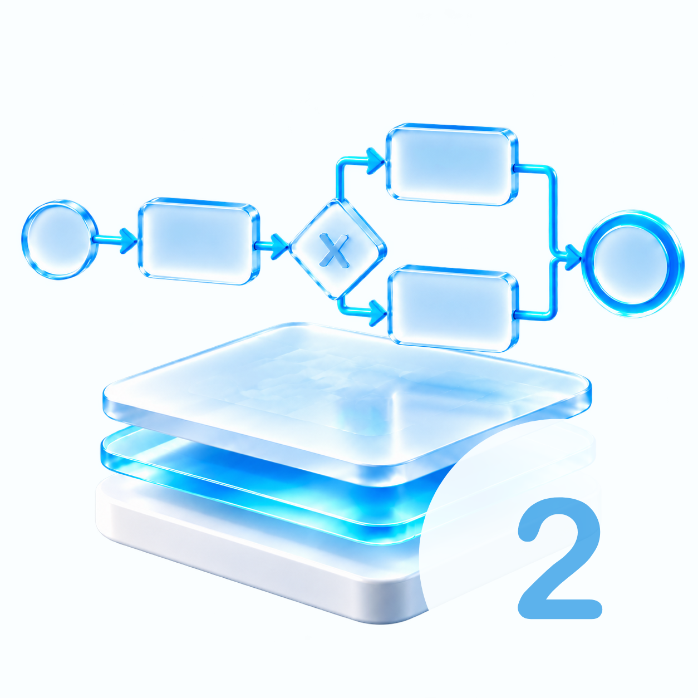</img>

Elementi modela poslovnog procesa prikazuju se pomoću karakterističnih simbola vidljivih na grafičkom dijagramu. Oblik svakog simbola otkriva vrstu objekta i njegovu osnovnu funkciju u procesu. Uz to, pojedinim elementima mogu se pridružiti tekstualni, brojčani ili logički podaci koji detaljnije opisuju ponašanje objekta u složenom modelu procesa. U ovoj ćemo skripti nadograditi osnovne objekte koje smo prethodno obradili i istražiti koje dodatne informacije možemo definirati unutar njih.

 

 

 

**🆙 Posljednje ažurirano: 21.10.2026.**

- ispravak na Slici 7.

## Sadržaj

- [Upravljanje poslovnim procesima (UPP - 199739)](#upravljanje-poslovnim-procesima-upp---199739)
- [(2) Dopunski atributi elemenata modela procesa](#2-dopunski-atributi-elemenata-modela-procesa)
  - [Sadržaj](#sadržaj)
- [1. Uvod](#1-uvod)
- [2. Nadogradnja poslovnog procesa `PRODATI ROBU`](#2-nadogradnja-poslovnog-procesa-prodati-robu)
- [2.1 Osnovne vrste događaja](#21-osnovne-vrste-događaja)
- [2.2 Osnovne vrste aktivnosti](#22-osnovne-vrste-aktivnosti)
  - [2.2.1 Radni korak (engl. Task)](#221-radni-korak-engl-task)
  - [2.2.2. Potproces (engl. Subprocess)](#222-potproces-engl-subprocess)
  - [2.2.3 Kako ispravno koristiti `send` i `receive` aktivnosti?](#223-kako-ispravno-koristiti-send-i-receive-aktivnosti)
- [Zadaci za Vježbu 2](#zadaci-za-vježbu-2)
  - [1. Proces upisa studenata na sveučilište](#1-proces-upisa-studenata-na-sveučilište)
  - [2. UPPTech - Implementacija softvera](#2-upptech---implementacija-softvera)

# 1. Uvod

Modeliranje poslovnih procesa širok je pojam koji obuhvaća izradu različitih vrsta modela za različite namjene. U literaturi ima više klasifikacija modela poslovnih procesa po različitim kriterijima. U pravilu možemo definirati 3 kriterija za klasifikaciju modela poslovnih procesa:

1. **Razina detaljnosti**: model procesa može biti opisni, analitički ili izvršivi (engl. _executable_)
2. **Faze razvoja**: model se može odnositi na postojeći proces (As is) ili na budući optimizirani proces (To Be) koji tek treba uspostaviti
3. **Pretežiti korisnici**: model može biti namijenjen poslovnim stručnjacima (među kojima je i menadžment), informatičarima ili korisnicima koji su izvan struke

Rekli smo da su objekti toka podataka (engl. _data flow objects_) osnovni elementi modela poslovnog procesa i u pravilu ih možemo podijeliti na **događaje**, **aktivnosti** i **skretnice**. To su osnovni elementi svakog modela poslovnog procesa. Ako neki model nema ta tri elementa, onda ga i ne možemo smatrati modelom procesa u smislu definicije dane u prošloj skripti.

Prema normi BPMN 2.0, formalno je moguće da model procesa nema nijedne skretnice, ali to onda znači da je više aktivnosti (ako ih ima) povezano slijednim tokom, odnosno da aktivnosti slijede jedna iza druge bez ikakvih uvjeta i zastoja. Tada model nije ništa drugo nego popis poslova koje treba obaviti, redom kako su navedeni u popisu.

Također, moguće je da model procesa nema nacrtan nijedan događaj, ali se tada podrazumijeva da postoji jedan početni i jedan završni događaj.

# 2. Nadogradnja poslovnog procesa `PRODATI ROBU`

Prisjetimo se poslovnog procesa `PRODATI ROBU` koji smo modelirali u prošloj skripti.

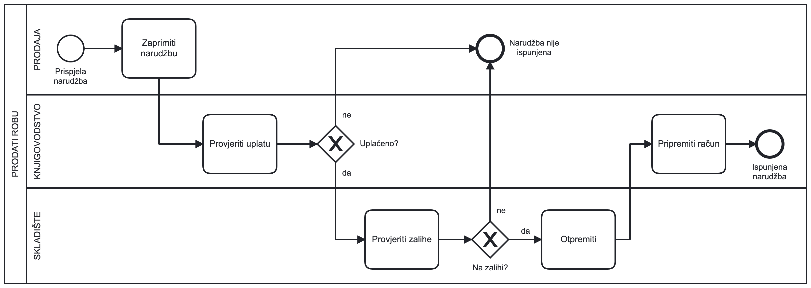

> Slika 1. Poslovni proces `PRODATI ROBU` koji smo definirali u prošloj skripti

Kroz ovaj proces naučili smo definirati spomenute osnovne elemente. Model smo nadogradili i dodali smo **polje** i dodatne **staze** kojima smo definirali aktere koji sudjeluju u procesu.

Za početak idemo nadograditi model različitim vrstama **događaja**.

# 2.1 Osnovne vrste događaja

Rekli smo da događaje definiramo **kružnicama** koje su povezane s tokom. Događaji su važni jer označavaju početak ili kraj neke aktivnosti ili procesa. Definirali smo dva osnovna tipa događaja:

- **Početni događaj** (engl. _Start Event_)
- **Završni događaj** (engl. _End Event_)

  
  <b>Kružnica</b> (za početni i završni događaj)

Početni događaj je **istovjetan početku prve aktivnosti**, dok završni događaj **nastaje kada završi zadnja aktivnost**.

U interpretaciji nekog dijagrama poslovnog procesa **nastupanje nekog događaja naziva se** **okidanje** jer se pojavom događaja omogućuje izvođenje aktivnosti koja slijedi poslije njega.

Pri određivanju nekog događaja uvijek treba razmotriti što je bio **uzrok** njegova nastanka i gdje je nastao te kakva je **posljedica** njegova pojavljivanja i gdje se ona vidi.

Evo nekoliko različitih primjera događaja:

- referent prodaje primio je e-mail sa zahtjevom za ponudu. Događaj je ovdje **trenutak kad je zahtjev zaprimljen** (koristimo _Message start event_)
- dostignuta je neka vremenska točka u kojoj se mora obaviti aktivnost, npr. **istjecanje roka za dostavu ponude**. Ovdje je događaj **istjecanje roka** (koristimo _Timer start event_)
- sat je otkucao 6:30 ujutro, a to je **trenutak početka radnog vremena**. Ovdje je događaj **početak radnog vremena** (koristimo _Timer start event_)
- isteklo je neko vrijeme koje smo čekali, npr. postavili smo _timer_ na 60 minuta za pečenje kolača. Ovdje je događaj **istjecanje vremena pripreme kolača** (koristimo _Intermediate Timer event ako je usred procesa ili Start Timer event ako je na početku procesa_)
- **roba** je stigla na skladište. Ovdje je događaj **dostava robe** (koristimo običan _start event_ ili _message start event_, ovisno o tome kako dobivamo potvrdu)
- ostvaren je neki uvjet koji smo postavili, npr. **kupac je potvrdio narudžbu** ili **kupac je platio račun**. Ovdje su događaji **potvrda narudžbe** i **plaćanje računa** (koristimo običan _abstract start event_ ili _Intermediate event_ ako je usred procesa)
- pojavila se pogreška tijekom provedbe neke aktivnosti. Na primjer, ako je otkazao stroj u proizvodnoj liniji, treba se **pojaviti događaj kvara stroja** (koristimo _Error event_)
- itd.

U BPMN notaciji događaja ima puno, a možemo ih podijeliti na više načina. Mi smo dosad spomenuli samo početne i završne događaje, ali postoje i **međudogađaji** (_engl. Intermediate events_) koji se javljaju tijekom izvođenja aktivnosti.

Međudogađaji su važni jer omogućuju da se aktivnost prekine i nastavi kasnije ili da se aktivnost ponovi ili pak da se aktivnost prekine i prebaci na neku drugu aktivnost. Više o međudogađajima vidjet ćemo kasnije, na vježbama UPP3 i UPP4.

**Međudogađaje** (_engl. Intermediate events_) definiramo kružnicom s unutarnjom koncentričnom kružnicom.

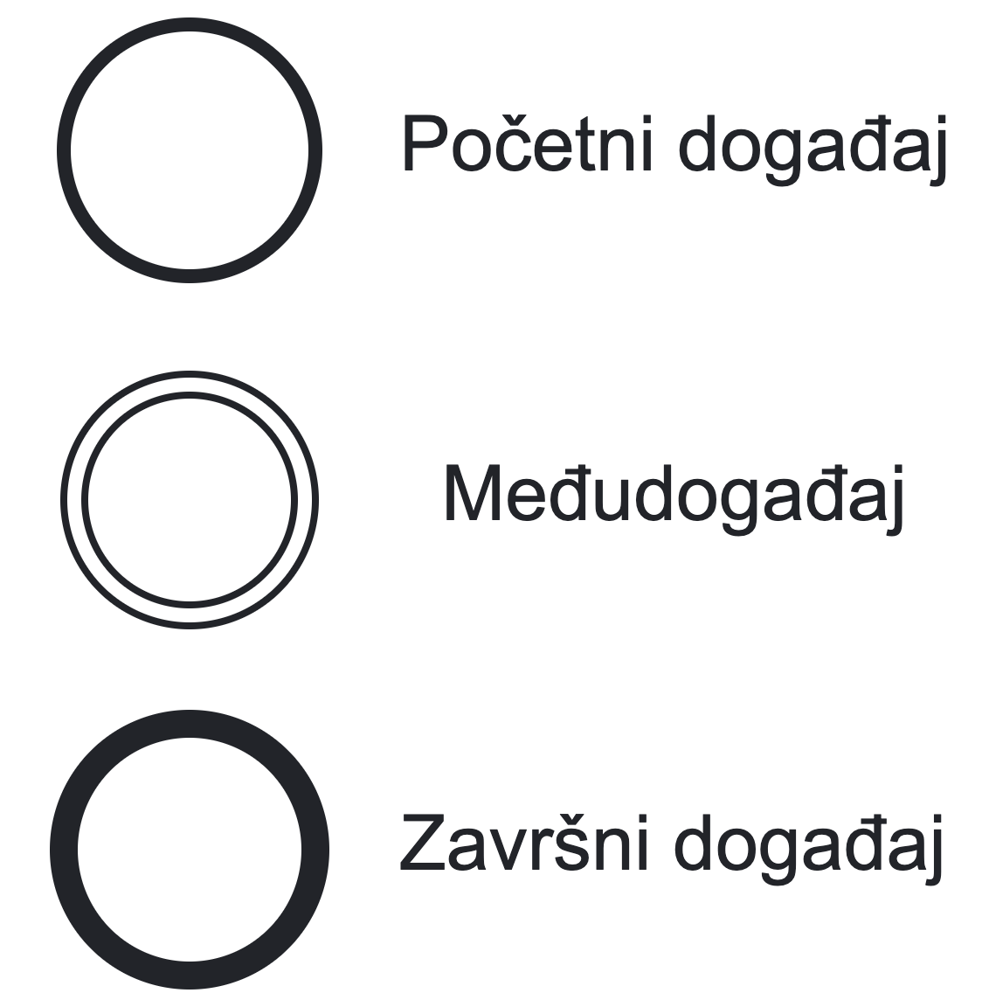

---

Početni i završni događaji koje smo dosad definirali bili su **neoznačeni**. U literaturi ih još nazivamo i **none** ili **blank** events.

U BPMN notaciji postoji više vrsta početnih i završnih događaja ovisno o njihovoj ulozi u procesu.

Camunda 8 podržava sljedeće vrste događaja:

- **Neoznačeni događaji** (engl. _None Event_)
- **Obavijest** (engl. _Message Event_)
- **Mjerač vremena** (engl. _Timer Event_)
- **Greška** (engl. _Error Event_)
- **Eskalacija** (engl. _Escalation Event_)
- **Ukidanje** ili **opoziv** (engl. _Terminate Event_)
- **Kompenzacija** (engl. _Compensation Event_)
- **Signal** (engl. _Signal Event_)
- **Priključna točka** (engl. _Link Event_)

Međutim, u standardnoj BPMN notaciji postoje i [druge vrste događaja](https://docs.camunda.io/docs/components/modeler/bpmn/bpmn-coverage/#events). S obzirom na to da se mi prvenstveno bavimo platformom Camunda, koristit ćemo samo one vrste događaja koje Camunda podržava.

Dva događaja koja ćemo često koristiti jesu **obavijest** (_engl. Message event_) i **mjerač vremena** (_engl. Timer event_).

  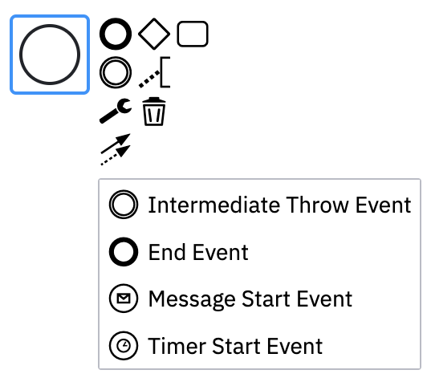

Dakle, odabiremo **početni događaj** i dodajemo mu oznaku (npr. `početak prodaje`) te dodajemo vrstu događaja. _Message event_ je označen pismom unutar kružnice, dok je _Timer event_ označen satom unutar kružnice.

  
  <b>Početni Message i Timer događaji</b>

**Završni događaj** također možemo označiti _Message eventom_ koji onda označava da je proces završio i moramo nekoga obavijestiti o tome: primjerice, šaljemo e-mail s potvrdom ili računom. Varijanta završnog _Message eventa_ izgleda ovako:

  
  <b>Završni Message događaj</b>

---

> Kako interpretirati ove događaje?

**Početne događaje** još nazivamo _prijamnim_ (_engl. catch event_) budući da reagiraju na neki vanjski događaj koji se dogodio.

- _primjer_: **zaprimanje e-maila** s narudžbom
- _primjer_: **pristigla je ponuda** za izradu web-stranice
- _primjer_: **pristigla je dokumentacija** za natječaj u interni IT-sustav
- _primjer_: **istekao je rok za dostavu ponude** nekoj javnoj ustanovi

**Završne događaje** još nazivamo _predajnim_ (_engl. throw event_) budući da oni indiciraju da se nešto dogodilo (čime aktivni proces završava), ali postoje i neke posljedice tog događaja – rezultat izvršavanja procesa preusmjerava se nekom vanjskom sustavu, započinje se neki drugi proces – proces se _predaje_ (prenosi) drugom procesu.

- _primjer_: **slanje e-maila** s potvrdom
- _primjer_: **slanje računa** kupcu
- _primjer_: **slanje obavijesti** nadređenom o dovršenom zadatku
- _primjer_: **slanje izvještaja** upravi o dovršenom projektu
- _primjer_: **dostava materijala** za potrebne građevinske radove
- _primjer_: **podmirenje obveza** prema dobavljaču

Postoje i **međudogađaji obavijesti** (_engl. Intermediate Message Events_) koji onda mogu biti **catch** ili **throw** ovisno o tome reagiraju li na neki vanjski događaj ili pak generiraju neki vanjski događaj.

Varijanta prijamnog međudogađaja obavijesti izgleda ovako, npr. **primanje e-maila s obaviješću usred procesa**:

  
  <b>Prijamni međudogađaj obavijesti (<i>engl. Intermediate catch message event</i>)</b>

Postoji i varijanta **predajnog** međudogađaja, npr. **slanje poruke usred procesa, najčešće u svrhu pokretanja nekog drugog procesa**:

  
  <b>Predajni međudogađaj obavijesti (<i>engl. Intermediate throw message event</i>)</b>

---

Idemo nadograditi naš proces **PRODATI ROBU** ažuriranjem događaja.

Kako imamo događaj "Prispjela narudžba", možemo zaključiti da je vjerojatno riječ o _Message eventu_ budući da je prispjela ili putem e-maila ili putem nekog drugog sustava koji šalje poruke na određeni komunikacijski kanal (ne mora biti e-mail).

Također, imamo 2 završna događaja, jedan za uspješno **ispunjenu narudžbu**, drugi za **neuspješno ispunjenu narudžbu**. Oba završna događaja možemo označiti _Message eventima_ jer će se u oba slučaja poslati e-mail ili obavijestiti klijent na neki drugi način.

  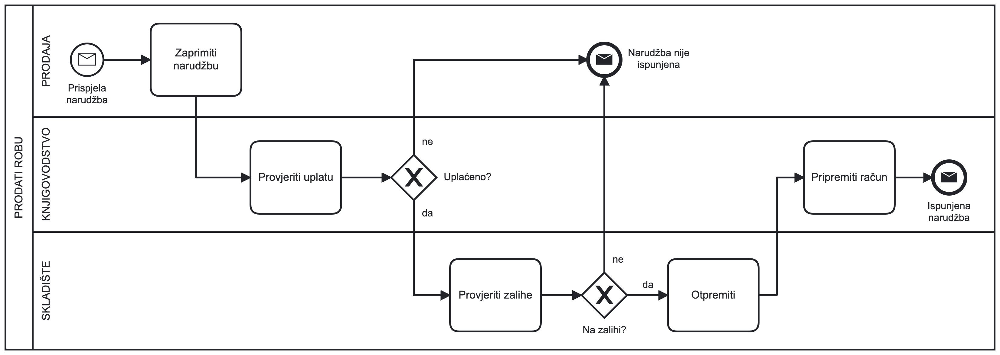

> Slika 2. Poslovni proces PRODATI ROBU s dodanim Message eventima

Prije nego što se prebacimo na vrste aktivnosti, pogledajmo još jedan primjer korištenja _Timer eventa_.

**Timer eventi** mogu biti korisni za definiranje vremenskih ograničenja ili rokova. Zamislimo jednostavni proces **PRIPREMA KOLAČA**. Zamislimo da radimo kolač koji se peče 60 minuta. Nakon tog vremena moramo ga izvaditi iz pećnice i pustiti da se ohladi u frižideru barem 2 sata. Nakon toga kolač možemo poslužiti gostima.

Vidimo da u definiciji procesa imamo vremenska ograničenja, a budući da se ona javljaju tijekom izvođenja aktivnosti, možemo koristiti _Intermediate Timer evente_.

---

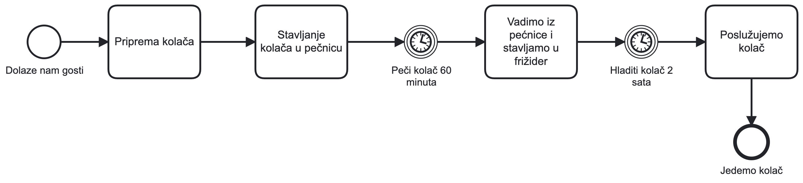

> Slika 3. Proces PRIPREMA KOLAČA s dodanim Message eventima

# 2.2 Osnovne vrste aktivnosti

Osim različitih vrsta događaja, imamo i različite vrste aktivnosti.

**Aktivnost** je prema normi BPMN opći (generički) pojam koji se koristi za opis svakog rada izvedenog u poslovnom procesu. Osnovni je simbol pravokutnik sa zaobljenim uglovima, unutar kojeg je opisan **naziv posla koji treba obaviti**.

Za izvođenje aktivnosti potrebni su neki **resursi** i **vrijeme**. Resursi se uzimaju iz organizacije ili iz okruženja, a vrijeme se odnosi na izvođenje ili trajanje aktivnosti.

Dakle, svaka **aktivnost** označava neku elementarnu radnju koja se u razmatranom dijagramu poslovnih procesa **ne raščlanjuje** i naziva se često i **radnim korakom**.

Složene aktivnosti u BPMN notaciji često definiramo kao **potprocese** (_engl. subprocess_).

### 2.2.1 Radni korak (engl. Task)

Radnih koraka u BPMN notaciji ima više vrsta. Mi smo do sada koristili samo opći (_engl. abstract_) radni korak. U BPMN notaciji postoji više vrsta radnih koraka:

- **Opći radni korak** (engl. _abstract task_)
- **Servisni radni korak ili servis** (engl. _service task_)
- **Prijamni radni korak** (engl. _receive task_)
- **Otpremni radni korak** (engl. _send task_)
- **Korisnički radni korak** (engl. _user task_)
- **Ručni radni korak** (engl. _manual task_)
- **Poslovno pravilo ili pravilo** (engl. _business rule task_)
- **Naputak** (engl. _script task_)

U pravilu ćemo koristiti sve radne korake osim naputka jer je naputak vrlo specifičan (koristi se pri razvoju procesno orijentiranih Camunda aplikacija).

U nastavku ćemo objasniti svaku vrstu radnog koraka:

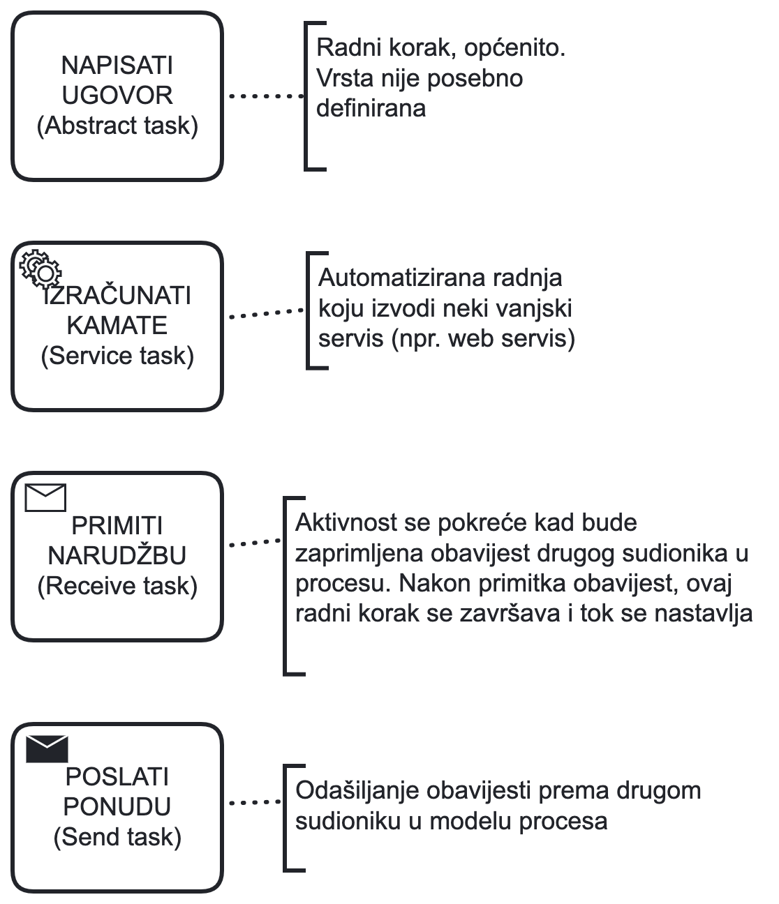

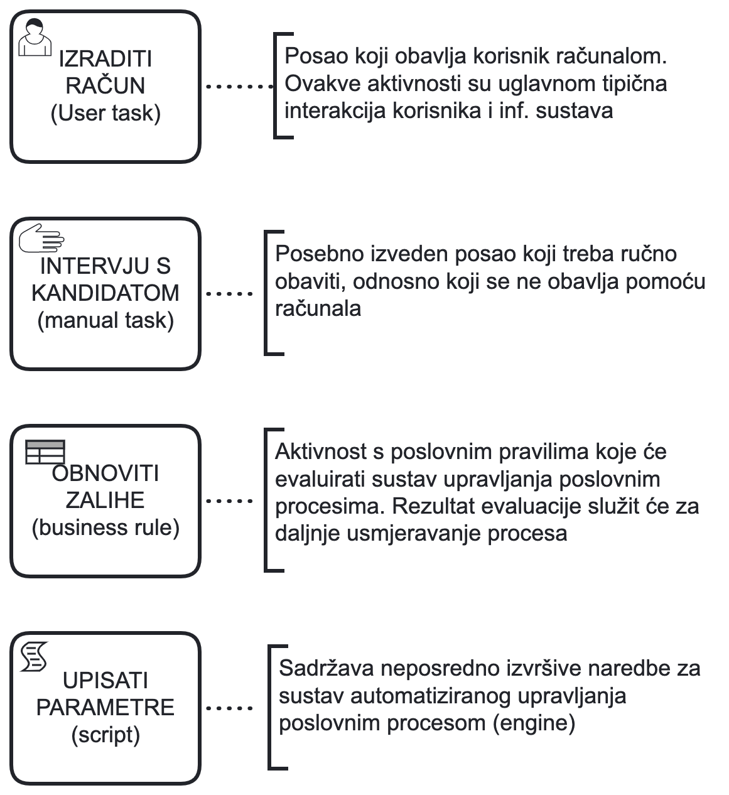

> Ono što vas zasad može zbunjivati jest razlika između **događaja obavijesti** (_engl. message events_) i prijamnih i otpremnih radnih koraka (_engl. send and receive tasks_). Razlike mogu biti zbunjujuće i zato ćemo ih detaljno izvježbati u sljedećoj skripti. Međutim, sada trebate zapamtiti da su događaji tzv. **okidači** koji pokreću neki proces ili vanjski potproces ili pak završavaju određeni proces. Međudogađaji se često koriste kao pasivni elementi koji čekaju da se dogodi neki događaj, dok radni koraci definiraju slijed aktivnosti koji se izvršava i često su vidljivi (_engl. trackable_) korisniku ili sustavu.

---

Vrsta radnje obavezno se navodi u analitičkom i izvršivom modelu procesa radi točnog opisa ponašanja aktivnosti u procesnim aplikacijama, gdje će se za svaku vrstu radnoga koraka generirati specifična programska procedura.

Idemo vidjeti kako možemo nadograditi naš proces **PRODATI ROBU** različitim vrstama radnih koraka.

- S obzirom na to da poslovni proces **PRODATI ROBU** započinje **message eventom** **Prispjela narudžba** (_engl. message start event_) koji predstavlja okidač našeg procesa, možemo preimenovati aktivnost koja slijedi nakon toga iz "Zaprimiti narudžbu" u "Obrada narudžbe" budući da je to radnja koja nam pobliže opisuje što se događa u toj aktivnosti.

- Aktivnost "Obrada narudžbe" možemo definirati kao **korisnički radni korak** (_engl. user task_) budući da je to radnja koju obavlja djelatnik poslovnice ili referent prodaje **na računalu kroz neki informacijski sustav**.

- Aktivnost "Provjeriti uplatu" možemo također definirati kao **korisnički radni korak** (_engl. user task_) jer se radi o radnji koju obavlja djelatnik poslovnice ili referent prodaje **na računalu kroz neki informacijski sustav**, ali ako je provjera automatska, odnosno ako se uplata provjerava automatski u računovodstvu nakon obrade narudžbe, onda možemo koristiti **servisni radni korak**.

- "Provjeriti zalihe" možemo definirati kao **servisni radni korak** (_engl. service task_) ako se provjera zaliha radi automatski. Međutim, kako je to neuobičajeno i manje vjerojatno za naš zadatak, možemo ga definirati kao **korisnički radni korak** ako korisnik provjerava zalihe kroz neki informacijski sustav ili kao **ručni radni korak** ako korisnik provjerava zalihe fizički, npr. odlaskom u skladište.

- "Otpremiti robu" možemo definirati također kao **ručni radni korak** (_engl. manual task_) jer se radi o fizičkoj radnji, odnosno odlasku u skladište i pakiranju robe. Međutim, uskoro ćete vidjeti kako preciznije definirati ovu aktivnost kroz **potproces**.

- "Pripremiti račun" možemo definirati kao **korisnički radni korak** (_engl. user task_) jer se radi o radnji koju obavlja djelatnik iz računovodstva kroz neki IS.

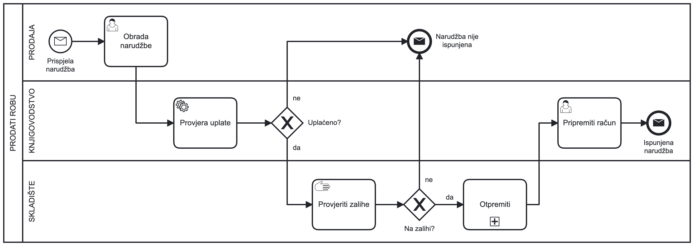

> Slika 4. Poslovni proces `PRODATI ROBU` s različitim vrstama radnih koraka

### 2.2.2. Potproces (engl. Subprocess)

Potproces je posebna vrsta složene aktivnosti koju **ne možemo nazvati radnim korakom** budući da on nije elementarna radnja, već je **složenija radnja koja se sastoji od više manjih radnji**. Potproces se koristi za **grupiranje** i **organizaciju** aktivnosti koje se **ponavljaju** u procesu ili su **složene** i **ne mogu se opisati jednostavno**.

Primjer potprocesa iz našeg poslovnog procesa PRODATI ROBU je postojeća aktivnost "Otpremiti".

Ako usporedimo tu aktivnost, npr. s aktivnošću "Provjeriti uplatu" ili "Pripremiti račun", vidimo da je "Otpremiti robu" složenija radnja koju trebamo malo preciznije definirati. Za to koristimo **potproces**.

Potproces je doslovno **proces unutar procesa** te može biti **sklopljen** (_engl. collapsed_) ili **proširen** (_engl. expanded_).

- **Sklopljeni potproces** je onaj koji je skriven, odnosno ne vidimo unutrašnjost potprocesa.
- **Prošireni potproces** je onaj koji je vidljiv i unutar kojeg možemo vidjeti sve aktivnosti, skretnice, _flow_... (stvarni proces).

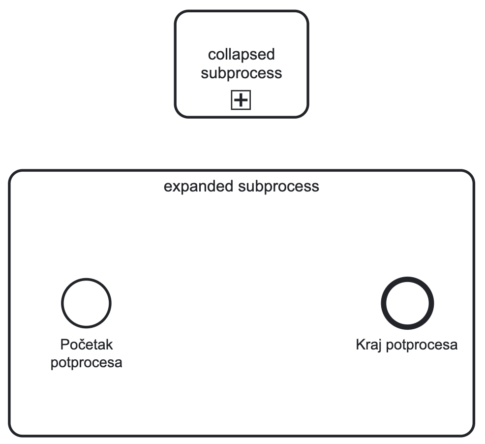

> Prošireni potproces mora imati **početni i završni događaj** koji označavaju početak i kraj potprocesa!

---

Kako ćemo definirati potproces "Otpremiti"?

Proces započinje **primitkom naloga za otpremu** u skladište, nakon čega je **potrebno provjeriti zalihe**. Ako je roba na zalihama, možemo spakirati robu i dogovoriti prijevoz s dostavnom službom. Nakon toga šaljemo robu i proces završava otpremom robe sa skladišta. Ako roba nije na zalihi, proces završava bez otpreme.

Nakon potprocesa vraćamo se na glavni proces kroz XOR skretnicu "Otpremljeno?". Ako je roba otpremljena, pripremamo račun i završavamo s procesom. Ako nije, narudžba nije ispunjena.

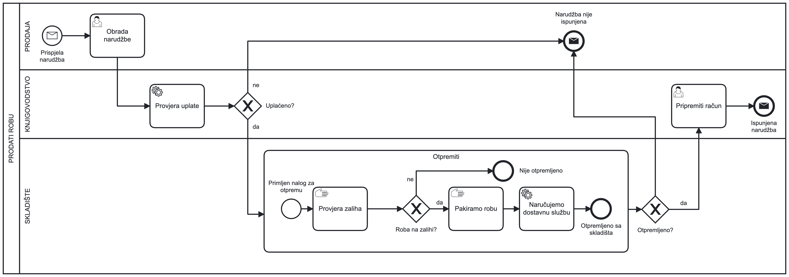

> Slika 5. Poslovni proces PRODATI ROBU s dodanim potprocesom "Otpremiti"

### 2.2.3 Kako ispravno koristiti `send` i `receive` aktivnosti?

Prijamni (_engl. receive_) i otpremni (_engl. send_) radni koraci koriste se za komunikaciju između više procesa, procesa i vanjskog sustava ili procesa i vanjske jedinice. **Česta greška** je koristiti ove aktivnosti unutar jednog procesa između dviju staza (npr. dvaju odjela u tvrtki). U tom slučaju komunikacijske veze potrebno je definirati kroz slijedne tokove.

Recimo da imamo primjer procesa u web-trgovini koja nema svoje skladište, već koristi vanjsko skladište za otpremu robe. Recimo da skladište posluje s mnogo trgovina i komunikacija se odvija prvenstveno putem e-maila. U tom slučaju koristimo **send** i **receive** aktivnosti za komunikaciju između tih entiteta.

Međutim, kako se radi o udaljenim entitetima, ne želimo ih definirati unutar istog polja.

Dakle, sljedeće je pogrešno:

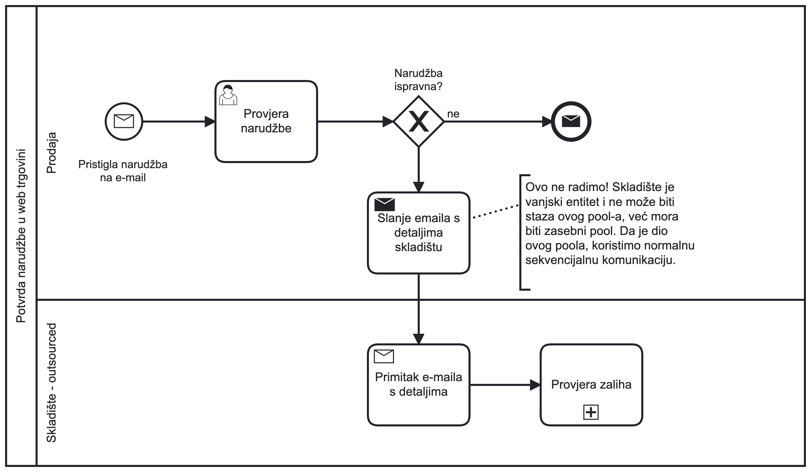

> Slika 6. Pogrešan način korištenja `send` i `receive` aktivnosti unutar istog polja

Da se radi o nekoj maloj trgovini koja ima svoje malo interno skladište, onda bismo to mogli ovako prikazati, ali bismo umjesto **send** i **receive** aktivnosti koristili **obične sekvencijalne veze**.

S druge strane, ako se radi o **vanjskom skladištu**, onda je to ispravno **pokazati na sljedeći način**:

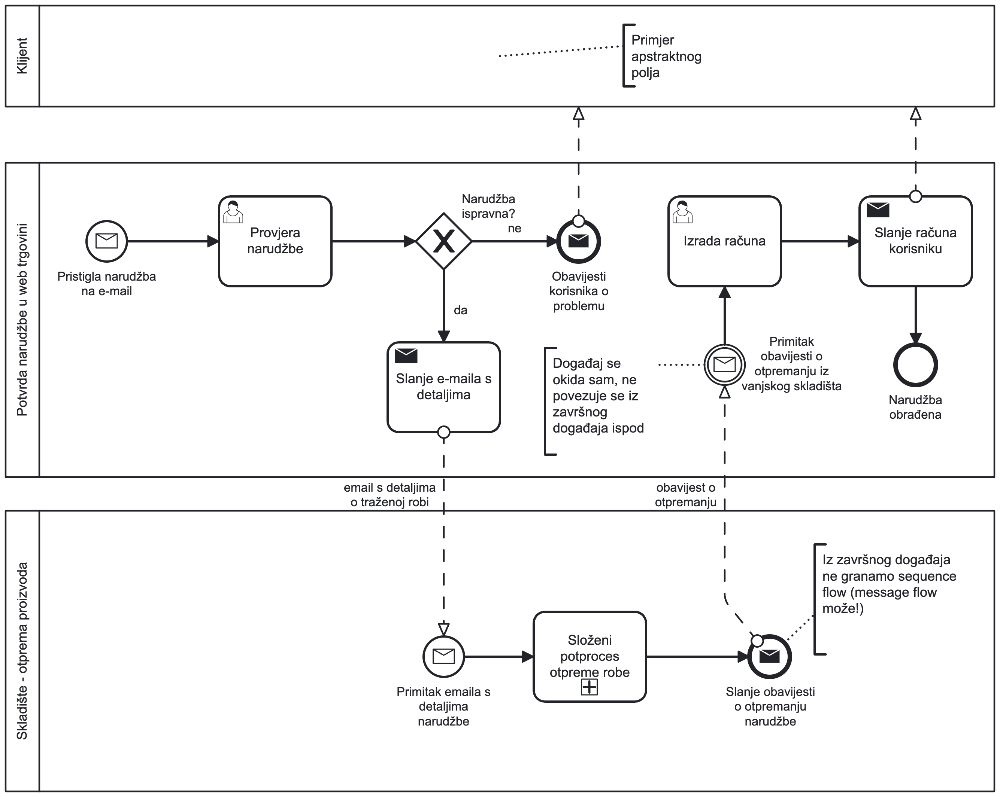

> Slika 7. Ispravan način korištenja `send` i `receive` aktivnosti između dvaju polja.
> _Napomena:_ U modelu postoji lebdeći (_floating_) element (međudogađaj – "Primitak obavijesti o otpremanju iz vanjskog skladišta") koji nije povezan sekvencijalnim tokom s ostatkom modela. Pokazat ćemo kako rješavati ovakve situacije na vježbama UPP3.

> **Zapamti!**

- U pravilu želimo koristiti polje i staze za komunikaciju između entiteta unutar jednog procesa (npr. odjeli unutar iste tvrtke). Rijetko želimo klijenta prikazati stazom unutar procesa, osim ako klijent nije jedan od ključnih dionika u procesu (npr. u procesu korisničke podrške). Međutim, ako je samo vanjski inicijator procesa, onda ga možemo prikazati vanjskim poljem ili samo navesti u opisu početnog događaja.
- Dva ili više polja koristimo kada naši entiteti nisu dio iste cjeline, već su udaljeni i komuniciraju prvenstveno kroz komunikacijske kanale (npr. e-mail) ili nemaju povezani interni informacijski sustav. Npr. tvrtka koja koristi vanjsko skladište za otpremu robe, tvrtka koja koristi vanjskog dobavljača za nabavu sirovina, dostavna služba koja dostavlja robu iz skladišta do kupca itd.

Ove ćemo detalje obraditi na budućim vježbama.

# Zadaci za Vježbu 2

Na temelju sljedećih opisa poslovnih procesa i do sada obrađene notacije BPMN 2.0 **izradite modele poslovnih procesa u alatu po vlastitom izboru**.

Modele izvezite u formatu **PNG** ili napravite snimku zaslona, zatim sve datoteke zapakirajte u ZIP-arhivu i učitajte rješenja na **Merlin**.

Slobodno dodajte napomenu ako želite dobiti povratnu informaciju o svojim rješenjima.

## 1. Proces upisa studenata na sveučilište

Poslovni proces započinje objavom natječaja za upise na studije u određenoj akademskoj godini. Prijave za upis i odabir studija kandidati podnose online putem Nacionalnog informacijskog sustava za upise na visoka učilišta (NISpVU), poznatijeg kao Postani student. Po završetku roka za prijave sustav generira rang-liste kandidata za upis na pojedine studijske programe. U slučaju posebnih okolnosti, primjerice ponavljanja ispita iz pojedinog predmeta na maturi, upisi se mogu odgoditi za određeni broj dana.

Svako sveučilište (ili druga javna obrazovna ustanova) zaprima rang-liste, nakon čega se provodi ručna provjera dostavljene dokumentacije. Ako postoje nedostaci u dokumentaciji, sveučilište o tome obavještava NISpVU, a problematična dokumentacija šalje se na doradu. U slučaju ispravne dokumentacije (ili nakon ispravaka) sveučilište započinje interni proces evaluacije kandidata na temelju njihovih rezultata i vlastitih kriterija za upis, poput provođenja prijamnih ispita, intervjua i sličnog.

Nakon završetka evaluacije sveučilište generira konačne rang-liste kandidata za upis na pojedine studijske programe, obavještava potencijalne studente te započinje teći rok za eventualne žalbe kandidata. Nakon isteka roka sveučilište razmatra pristigle žalbe (ako ih ima) i svaku rješava pojedinačno. Žalba se može prihvatiti ili odbiti. U slučaju složenijih žalbi, primjerice onih vezanih uz bodovanje na prijamnom ispitu, pravna služba sveučilišta može donijeti odluku o ponovnom bodovanju kandidata ili primjeni neke druge evaluacijske metode ako ta metoda (npr. intervju) nije prikladna za tog pojedinca (npr. u slučaju invaliditeta).

Nakon što su sve žalbe riješene, sveučilište objavljuje konačne rang-liste kandidata za upis na svoje studijske programe te započinje proces upisa studenata. Upisi se provode putem interne aplikacije sveučilišta, a nastala dokumentacija šalje se studentima putem e-maila te arhivira u internom sustavu sveučilišta. Sve navedene radnje provodi Ured za studente i upise.

Po završetku jesenskog upisnog roka proces je završen, a studenti započinju svoje akademsko putovanje na sveučilištu.

## 2. UPPTech - Implementacija softvera

Tvrtka UPPTech odlučila je implementirati novi softver za upravljanje poslovnim procesima. Tvrtka se sastoji prvenstveno od menadžerskog tima, koji donosi poslovne odluke, i malog internog IT-tima, koji održava informacijski sustav tvrtke.

Proces započinje kada menadžerski tim ustanovi potrebu za implementacijom novog softvera. IT-tim tada provjerava dostupni softver na tržištu i utvrđuje postoji li rješenje koje zadovoljava potrebe tvrtke.

Ako takav softver postoji, menadžerski tim dogovara njegovu kupnju, a IT-tim ga instalira na server tvrtke. Time proces završava.

Ako odgovarajući softver ne postoji, IT-tim odlučuje povjeriti razvoj novog rješenja vanjskoj tvrtki i kontaktira tvrtku CrazyTech. CrazyTech zaprima ponudu putem e-pošte i procjenjuje troškove razvoja. O tome obavještava menadžerski tim UPPTecha. Ako je ponuda prihvaćena, menadžerski tim šalje potvrdu, čime započinje složeni proces razvoja softverskog rješenja. Ako je ponuda odbijena, proces završava.

Složeni proces razvoja softverskog rješenja započinje definiranjem zahtjeva, dizajnom i razvojem softvera. Nakon razvoja softver se testira. Ako testiranje prođe uspješno, softver se postavlja na server tvrtke UPPTech i time proces završava. Ako testiranje ne prođe uspješno, postupak se vraća u fazu razvoja.
