# Upravljanje poslovnim procesima ([UPP - 199739](https://fipu.unipu.hr/fipu/predmet/upp))

**Nositelj**: izv. prof. dr. sc. Darko Etinger  
**Asistent**: Luka Blašković, mag. inf.

**Ustanova**: Sveučilište Jurja Dobrile u Puli, Fakultet informatike u Puli

</img>

# (4) Smjernice u modeliranju, boundary eventi i predlošci tokova rada

</img>

 

 
Cilj je ove skripte dati pregled načela i smjernica za modeliranje poslovnih procesa u notaciji BPMN 2.0. Dosad ste upoznali osnovne elemente, tokove i događaje. Osim poznavanja elemenata (sintakse), važno je da model bude dosljedan i razumljiv svim dionicima te da vjerno prikazuje stvarni poslovni proces. U ovoj ćemo se skripti usredotočiti na izvršivost procesa, imenovanje i upotrebu međudogađaja, modeliranje komunikacije te upotrebu rubnih događaja (_boundary events_). Predstavit ćemo i najčešće predloške tokova rada u notaciji BPMN.

 

**🆙 Posljednje ažurirano: 18. 11. 2026.**

## Sadržaj

- [Upravljanje poslovnim procesima (UPP - 199739)](#upravljanje-poslovnim-procesima-upp---199739)
- [(4) Smjernice u modeliranju, boundary eventi i predlošci tokova rada](#4-smjernice-u-modeliranju-boundary-eventi-i-predlošci-tokova-rada)
  - [Sadržaj](#sadržaj)
- [1. Smjernice za modeliranje procesa](#1-smjernice-za-modeliranje-procesa)
  - [1.1 Kada koristiti aktivnost, a kada događaj?](#11-kada-koristiti-aktivnost-a-kada-događaj)
  - [1.2 Imenovanje aktivnosti i događaja](#12-imenovanje-aktivnosti-i-događaja)
    - [Imenovanje aktivnosti](#imenovanje-aktivnosti)
    - [Imenovanje događaja](#imenovanje-događaja)
    - [Imenovanje međudogađaja po vrsti](#imenovanje-međudogađaja-po-vrsti)
  - [1.3 Ključne točke i čekanje u procesu](#13-ključne-točke-i-čekanje-u-procesu)
  - [1.4 Slanje i zaprimanje poruka](#14-slanje-i-zaprimanje-poruka)
  - [1.5 Komunikacija između polja i staza](#15-komunikacija-između-polja-i-staza)
  - [1.6 Entiteti na informacijskim tokovima (_eng. Message Flow Entities_)](#16-entiteti-na-informacijskim-tokovima-eng-message-flow-entities)
- [2. Boundary event (Međudogađaji na aktivnostima)](#2-boundary-event-međudogađaji-na-aktivnostima)
  - [2.1 Vrste interrupting boundary eventa](#21-vrste-interrupting-boundary-eventa)
  - [2.2 Vrste non-interrupting boundary eventa](#22-vrste-non-interrupting-boundary-eventa)
- [3. Predlošci tokova rada](#3-predlošci-tokova-rada)
  - [3.1 Osnovni predlošci za upravljanje slijedom](#31-osnovni-predlošci-za-upravljanje-slijedom)
    - [WCP-1 Slijed (engl. Sequence)](#wcp-1-slijed-engl-sequence)
    - [WCP-2 Paralelno dijeljenje (engl. Parallel Split)](#wcp-2-paralelno-dijeljenje-engl-parallel-split)
    - [WCP-3 Sinkronizacija (engl. Synchronization)](#wcp-3-sinkronizacija-engl-synchronization)
    - [WCP-4 Ekskluzivni izbor (engl. Exclusive Choice)](#wcp-4-ekskluzivni-izbor-engl-exclusive-choice)
    - [WCP-5 Jednostavno spajanje (engl. Simple Merge)](#wcp-5-jednostavno-spajanje-engl-simple-merge)
  - [3.2 Predlošci za grananje, sinkronizaciju i iteraciju](#32-predlošci-za-grananje-sinkronizaciju-i-iteraciju)
    - [WCP-6 Višestruki izbor (engl. Multiple Choice)](#wcp-6-višestruki-izbor-engl-multiple-choice)
    - [WCP-7 Strukturno sinkronizirano spajanje (engl. Structured Synchronizing Merge)](#wcp-7-strukturno-sinkronizirano-spajanje-engl-structured-synchronizing-merge)
    - [WCP-8 Nesimetrično sinkronizirano spajanje (engl. Acyclic Synchronizing Merge)](#wcp-8-nesimetrično-sinkronizirano-spajanje-engl-acyclic-synchronizing-merge)
    - [WCP-9 Proizvoljno ponavljanje (engl. Arbitrary Cycles)](#wcp-9-proizvoljno-ponavljanje-engl-arbitrary-cycles)
  - [3.3 Predlošci za okidače](#33-predlošci-za-okidače)
    - [WCP-10 Prolazni okidač (engl. Transient Trigger)](#wcp-10-prolazni-okidač-engl-transient-trigger)
    - [WCP-11 Stalni okidač (engl. Persistent Trigger)](#wcp-11-stalni-okidač-engl-persistent-trigger)
- [Zadaci za Vježbu 4](#zadaci-za-vježbu-4)
  - [1. ServisPlus d.o.o. - Popravak kućanskih uređaja](#1-servisplus-doo---popravak-kućanskih-uređaja)
  - [2. McDonalds franšiza - Obrada, priprema, dostava i naplata narudžbi](#2-mcdonalds-franšiza---obrada-priprema-dostava-i-naplata-narudžbi)

# 1. Smjernice za modeliranje procesa

U notaciji BPMN postoje tri glavna objekta toka:

1. **Događaji** (_engl. Events_)
2. **Aktivnosti** (_engl. Activities_)
3. **Skretnice** (_engl. Gateways_)

Premda su razlike između ovih objekata jasne, ponekad je teško odrediti koji objekt koristiti za modeliranje određene radnje u procesu. Ukratko ćemo ponoviti definicije:

- **Događaji** označavaju određene trenutke u procesu koji označavaju promjenu stanja procesa, poput početka (_start event_), završetka (_end event_) ili ključnih točaka između (_intermediate event_) sljedova aktivnosti. Oni su **pasivni elementi** i ne **podrazumijevaju aktivnost**, već **signaliziraju** da se određeni uvjet ispunio ili stanje procesa promijenilo.
- **Aktivnosti** predstavljaju zadatke ili skup poslovnih zadataka koji se trebaju izvršiti kako bi proces "napredovao". Rekli smo da su za izvođenje aktivnosti potrebni neki **resursi** i **vrijeme**. Radi se o **operativnim elementima procesa**.
- **Skretnice** omogućuju donošenje odluka unutar procesa, usmjeravajući tijek rada prema različitim pravcima na temelju definiranih uvjeta. Skretnice su ključne za **razgranavanje** i **kontrolu toka procesa**, a do sad smo naučili nekoliko vrsta skretnica (ekskluzivne, paralelne, inkluzivne) te varijante grananja i spajanja.

## 1.1 Kada koristiti aktivnost, a kada događaj?

Prilikom modeliranja, praktično je postaviti si nekoliko pitanja kako bismo odredili je li riječ o aktivnosti ili događaju.

Primjerice, ako se pitate _"Što se događa u procesu?"_, tada je vjerojatno da je riječ o aktivnosti. S druge strane, ako se pitate _"Kada se nešto događa ili se dogodilo u procesu?"_, tada je vjerojatno da je riječ o događaju.

_Primjer: Proces naručivanja proizvoda u web trgovini_

Moguće su sljedeće **aktivnosti**:

- "Unos podataka o kupcu",
- "Unos podataka o proizvodu",
- "Plaćanje",
- "Pakiranje",
- "Dostava"
- "Izrada računa"

Primjeri **događaja** u istom procesu:

- "Primljen zahtjev za narudžbu",
- "Proizvod poslan",
- "Plaćanje izvršeno"
- "Kupac obaviješten e-poštom"
- "Proizvod isporučen"

### Početni i završni događaji u modelu <!-- omit in toc -->

Kada u modeliranju želimo prikazati srodnu aktivnost odmah nakon događaja, praktično je **spojiti aktivnost i događaj u jedan objekt**. Tada možemo kombinirati događaj i aktivnost u događaj s dopunskim atributima (npr. _message start event_ ili _timer intermediate catch event_).

_Primjer:_ _start event_ naziva "Obrada po primitku narudžbe" može zamijeniti (biti kratica za) _start event_ "Pristigla narudžba" + aktivnost "Obrada narudžbe".

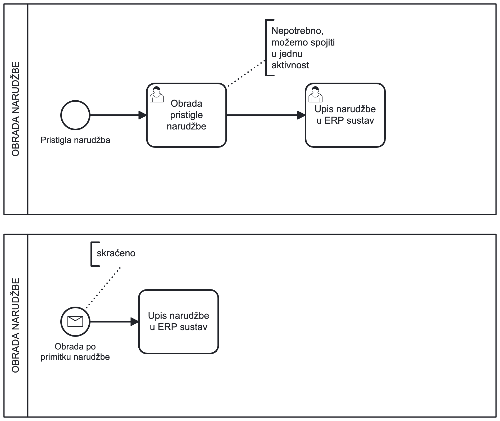</img>

> Slika 1. Ponekad možemo događaj + aktivnost zamijeniti jednim događajem s dopunskim atributima - ali pripazite da ispravno imenujete takav događaj. Kako je novi objekt događaj, nećemo ga imenovati kao aktivnost, već koristimo **pasivan glagolski oblik**. [BPMN model](models/diagram_1.bpmn)

"Pristigla narudžba" prikazujemo kao _start event_ jer se radi o završenoj radnji koja se dogodila u prošlosti. S druge strane, "Upis narudžbe u ERP sustav" prikazujemo kao _user task_ jer se radi o radnji koju je potrebno poduzeti kako bi proces "napredovao".

_Primjer:_ _End event_ naziva "Proizvod isporučen kupcu" može zamijeniti (biti kratica za) _manual task_ "Isporuka proizvoda kupcu" + _end event_ "Proizvod isporučen".

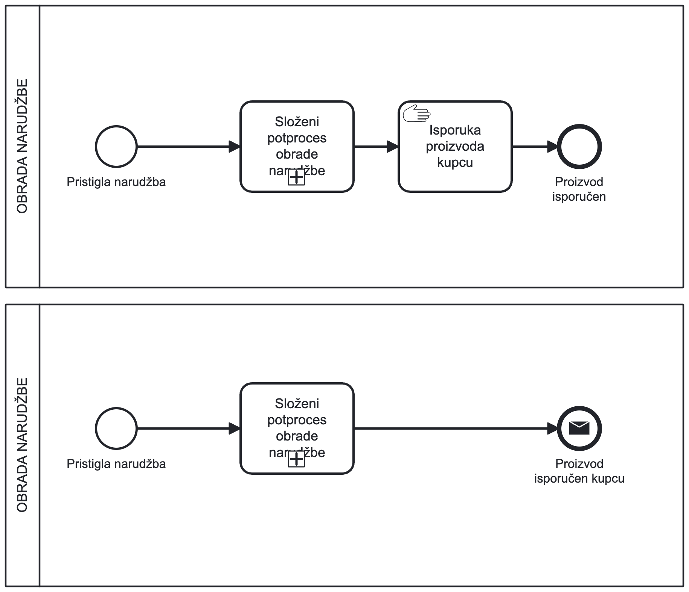</img>

> Slika 2. Isto kao kod početnog događaja, možemo i završni događaj + aktivnost zamijeniti jednim završnim događajem s dopunskim atributima - ali pripazite da ispravno imenujete takav događaj. Kako je novi objekt događaj, nećemo ga imenovati kao aktivnost, već koristimo **prošli glagolski oblik**.

## 1.2 Imenovanje aktivnosti i događaja

### Imenovanje aktivnosti

Naziv aktivnosti opisuje **što treba učiniti**. Navedite radnju i objekt na koji se odnosi. Možete koristiti **glagolsku imenicu**, **infinitiv** ili **imperativ**. Kad koristite glagol, odaberite aktivni oblik. Ako polje ili staza već označava izvršitelja, njegovo ime obično možete izostaviti. Ako ipak koristite prezent, upotrijebite treće lice.

<table>
  <thead>
    <tr><th colspan="3">Imenovanje aktivnosti</th></tr>
    <tr><th>✅ Ispravno imenovanje</th><th>❌ Neispravno imenovanje</th><th>Zašto je neispravno, neispravno?</th></tr>
  </thead>
  <tbody>
    <tr><td><em>Pakiranje proizvoda</em></td><td><em>Proizvod</em></td><td>Naveden je samo predmet rada. Nedostaje radnja koju treba obaviti.</td></tr>
    <tr><td><em>Provjeriti zalihe</em></td><td><em>Provjeriti</em></td><td>Nedostaje objekt radnje. Što treba provjeriti?</td></tr>
    <tr><td><em>Poslati potvrdu</em></td><td><em>Potvrda poslana</em></td><td>Naziv opisuje događaj nakon slanja. Aktivnost treba imenovati radnju slanja.</td></tr>
    <tr><td><em>Pripremi račun</em></td><td><em>Pripremaš račun</em></td><td>Drugo lice prezenta izravno se obraća izvršitelju. Za uputu upotrijebite imperativ „Pripremi račun”.</td></tr>
    <tr><td><em>Dostaviti paket</em> (u stazi „Dostavljač”)</td><td><em>Dostavljač</em></td><td>Naziv ponavlja ulogu iz staze. Iz njega se ne vidi što dostavljač treba učiniti.</td></tr>
    <tr><td><em>Provjerava zalihe</em> (ako se koristi prezent)</td><td><em>Provjeravam zalihe</em></td><td>Prvo lice prezenta opisuje radnju iz perspektive izvršitelja. Ako koristite prezent, upotrijebite treće lice.</td></tr>
  </tbody>
</table>

> Tablica 1. Primjeri imenovanja aktivnosti.

### Imenovanje događaja

Naziv događaja odgovara na pitanje **„Što se dogodilo?”** Izbjegavajte nazive poput „Početak procesa” i „Kraj procesa”. Imenujte konkretan povod za početak procesa ili poslovni ishod kojim proces završava. I „Obrada završena” može biti preopćenita ako čitatelju ostaje nejasno što je obrađeno i s kojim ishodom.

Za rezultat radnje uobičajen je **glagolski pridjev trpni** (_Proizvod poslan_), a moguć je i **glagolski pridjev radni** (_Narudžba pristigla_). Navedite sudionika kad je važno tko je što učinio ili primio. Kod međudogađaja možete imenovati **očekivani trenutak**, a kod vremenskog događaja navedite **rok, trajanje ili učestalost**.

<table>
  <thead>
    <tr><th colspan="3">Imenovanje događaja</th></tr>
    <tr><th>✅ Ispravno imenovanje</th><th>❌ Neispravno imenovanje</th><th>Zašto je neispravno, neispravno?</th></tr>
  </thead>
  <tbody>
    <tr><td><em>Zahtjev zaprimljen</em></td><td><em>Početak procesa</em></td><td>Generički naziv. Što je pokrenulo proces?</td></tr>
    <tr><td><em>Zahtjev odobren</em></td><td><em>Kraj procesa</em></td><td>Generički naziv. Kojim je ishodom proces završio?</td></tr>
    <tr><td><em>Račun plaćen</em></td><td><em>Obrada završena</em></td><td>Generički naziv. Što je obrađeno i s kojim ishodom?</td></tr>
    <tr><td><em>Potvrda poslana</em></td><td><em>Slanje potvrde</em></td><td>Opisuje aktivnost slanja. Događaj označava trenutak kad je potvrda poslana.</td></tr>
    <tr><td><em>Dostavljač preuzeo paket</em></td><td><em>Preuzeti paket</em></td><td>Ovako bismo imenovali aktivnost, ne događaj.</td></tr>
    <tr><td><em>Kada stigne odgovor kupca</em></td><td><em>Čekati odgovor kupca</em></td><td>Naziv treba odrediti trenutak u kojem se proces nastavlja, primjerice kada stigne odgovor kupca.</td></tr>
    <tr><td><em>Nakon 3 dana</em></td><td><em>Nakon nekog vremena</em></td><td>Vremenski događaj treba odrediti koliko traje čekanje.</td></tr>
  </tbody>
</table>

> Tablica 2. Primjeri imenovanja događaja.

> Napomena: Dosljedno imenovanje prema smjernicama BPMN-a olakšat će vam odabir između događaja i aktivnosti, a model će svim dionicima biti čitljiviji i razumljiviji.

### Imenovanje međudogađaja po vrsti

Sljedeće tablice prikazuju primjere imenovanja četiriju vrsta međudogađaja na sekvencijalnom toku. Njihovu ulogu u modelu pogledajte u odjeljcima [1.3 Ključne točke i čekanje u procesu](#13-ključne-točke-i-čekanje-u-procesu) i [1.4 Slanje i zaprimanje poruka](#14-slanje-i-zaprimanje-poruka).

  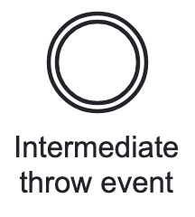
  <code>Intermediate throw event</code> za označavanje <b>ključnih točaka</b> u procesu, tzv. <b>milestone event</b>

<table>
  <thead>
    <tr><th colspan="2">Intermediate throw event</th></tr>
    <tr><th>✅ Ispravno imenovanje</th><th>❌ Neispravno imenovanje</th></tr>
  </thead>
  <tbody>
    <tr><td>Tijesto se dignulo</td><td>Dizanje tijesta</td></tr>
    <tr><td>Paket spreman za slanje</td><td>Priprema paketa</td></tr>
    <tr><td>Roba zapakirana</td><td>Pakiranje robe</td></tr>
    <tr><td>Bilješke pohranjene</td><td>Pohrana bilješki</td></tr>
    <tr><td>Vrijeme isteklo</td><td>Mjerenje vremena</td></tr>
    <tr><td>Hrana spremna</td><td>Priprema hrane</td></tr>
    <tr><td>Vremenska prognoza prikladna</td><td>Provjera vremenske prognoze</td></tr>
    <tr><td>Proizvod na zalihi</td><td>Provjera zalihe proizvoda</td></tr>
    <tr><td>Dokument odobren</td><td>Odobravanje dokumenta</td></tr>
    <tr><td>Račun izdan</td><td>Izdavanje računa</td></tr>
    <tr><td>Faktura izrađena</td><td>Izrada fakture</td></tr>
    <tr><td>Knjiga pročitana</td><td>Čitanje knjige</td></tr>
  </tbody>
</table>

> Tablica 3. Imenovanje međudogađaja tipa _Intermediate Throw Event_.

  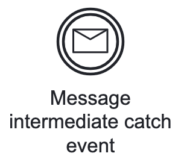
  <code>Message Intermediate Catch event</code> - označava <b>čekanje na primitak vanjskog signala ili poruke</b>. Proces se nastavlja nakon primitka signala ili poruke.

<table>
  <thead>
    <tr><th colspan="2">Message Intermediate Catch event</th></tr>
    <tr><th>✅ Ispravno imenovanje</th><th>❌ Neispravno imenovanje</th></tr>
  </thead>
  <tbody>
    <tr><td>Primljen signal</td><td>Slanje signala</td></tr>
    <tr><td>Primljena odbijenica</td><td>Slanje odbijenice</td></tr>
    <tr><td>Jednom kad pristigne odgovor</td><td>Slanje odgovora korisniku</td></tr>
    <tr><td>Po primitku obavijesti o dovršetku posla</td><td>Dovršavanje posla</td></tr>
    <tr><td>Potvrda primljena e-poštom</td><td>Klijent provjerava e-poštu...</td></tr>
    <tr><td>Kada pristigne poruka klijenta</td><td>Poruka poslana e-poštom</td></tr>
    <tr><td>Čekanje na primitak obavijesti o...</td><td>Djelatnik obavještava...</td></tr>
    <tr><td>Po primitku zahtjeva</td><td>Slanje zahtjeva</td></tr>
    <tr><td>Račun primljen</td><td>Račun spreman</td></tr>
    <tr><td>Poruka primljena e-poštom</td><td>Tri dana čeka poruku e-poštom</td></tr>
  </tbody>
</table>

> Tablica 4. Imenovanje međudogađaja tipa _Message Intermediate Catch Event_.

  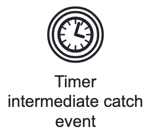
  <code>Timer Intermediate Catch event</code> - označava <b>specificirano čekanje</b> u procesu ili <b>početak određenog vremenskog razdoblja</b>

<table>
  <thead>
    <tr><th colspan="2">Timer Intermediate Catch event</th></tr>
    <tr><th>✅ Ispravno imenovanje</th><th>❌ Neispravno imenovanje</th></tr>
  </thead>
  <tbody>
    <tr><td>Nakon 3 dana</td><td>Nakon nekog vremena...</td></tr>
    <tr><td>Svaki ponedjeljak</td><td>Povremeno</td></tr>
    <tr><td>Svaki mjesec</td><td>S vremena na vrijeme</td></tr>
    <tr><td>Prošlo 5 minuta</td><td>Kad prođe vrijeme...</td></tr>
    <tr><td>Stigao ponedjeljak</td><td>Čekanje početka tjedna</td></tr>
    <tr><td>Prošla su dva tjedna</td><td>Čekaj</td></tr>
    <tr><td>90 minuta</td><td>Čekaj timer</td></tr>
    <tr><td>4 sata</td><td>Timer</td></tr>
    <tr><td>Nakon 15 minuta čekanja u koloni</td><td>Čekanje u koloni</td></tr>
    <tr><td>Nakon 30 minuta čekanja na obradu narudžbe</td><td>Čekanje na obradu narudžbe</td></tr>
    <tr><td>Nakon 2 dana bez odgovora</td><td>Čekanje na odgovor</td></tr>
    <tr><td>Nakon 1 sata bez poruke</td><td>Čekanje na primitak poruke</td></tr>
  </tbody>
</table>

> Tablica 5. Imenovanje međudogađaja tipa _Timer Intermediate Catch Event_.

  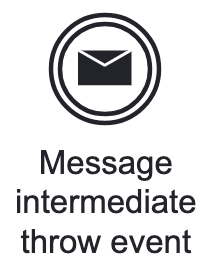
  <code>Message Intermediate throw event</code> - koristi se za <b>slanje signala drugim sudionicima</b> u procesu ili za <b>pokretanje drugih procesa</b>.

<table>
  <thead>
    <tr><th colspan="2">Message Intermediate throw event</th></tr>
    <tr><th>✅ Ispravno imenovanje</th><th>❌ Neispravno imenovanje</th></tr>
  </thead>
  <tbody>
    <tr><td>Klijent obaviješten</td><td>Obavijesti klijenta</td></tr>
    <tr><td>SMS poslan</td><td>Pošalji SMS djelatniku</td></tr>
    <tr><td>Kupcu poslana poruka e-poštom</td><td>Pošalji poruku e-poštom</td></tr>
    <tr><td>Račun dostavljen klijentu</td><td>Slanje računa kupcu</td></tr>
    <tr><td>Proces X signaliziran</td><td>Signalizirati procesu X</td></tr>
    <tr><td>Inicijaliziran proces narudžbe</td><td>Inicijalizirati proces narudžbe</td></tr>
  </tbody>
</table>

> Tablica 6. Imenovanje međudogađaja tipa _Message Intermediate Throw Event_.

Nazivi u desnom stupcu opisuju aktivnosti umjesto događaja.

> **Zapamti**: Naziv međudogađaja treba jasno opisivati **trenutak** u kojem se nešto dogodilo ili će se dogoditi, odnosno **stanje** koje je nastupilo ili se očekuje. Pri opisivanju rezultata radnje koristite pasivni oblik i izbjegavajte infinitiv. **Izbjegavajte imenovati događaje kao aktivnosti.**

## 1.3 Ključne točke i čekanje u procesu

**Međudogađaji** (_engl. Intermediate Events_) koriste se za označavanje **ključnih točaka (događaja) između početka i kraja procesa**. Preciznije, koriste se za modeliranje ključnih trenutaka u procesu koji **ne predstavljaju početak ili kraj procesa**, ali svakako mogu promijeniti tijek izvođenja.

Međudogađaje možemo prikazati na sekvencijalnom toku između aktivnosti ili na rubu aktivnosti kao [**boundary event**](#2-boundary-event-međudogađaji-na-aktivnostima).

### Ključne točke u procesu <!-- omit in toc -->

_Intermediate Throw Event_ je korisno koristiti kada želimo **naglasiti ključne točke u procesu**, tzv. _milestone_ (npr. "Roba spremna", "Vrijeme isteklo", "Proizvod na zalihi", "Hrana spremna"). Bez obzira na to, procesni je tijek moguće definirati i bez njih, ali na ovaj način možemo značajno **poboljšati čitljivost i razumljivost procesa**.

_Primjer: Proces pripreme hrane u restoranu._

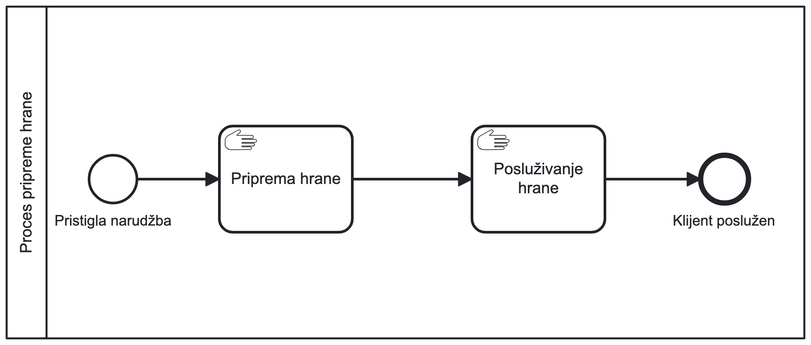</img>

> Slika 3. Primjer modeliranog procesa pripreme hrane u restoranu bez _milestone_ događaja.

Možemo dodati _Intermediate Throw Event_ "Hrana spremna" kako bismo naglasili ključnu točku u ovom procesu. Ovaj događaj ne utječe na sekvencijalni tijek procesa, već samo signalizira da je hrana spremna za posluživanje te na taj način postižemo bolju čitljivost procesa.

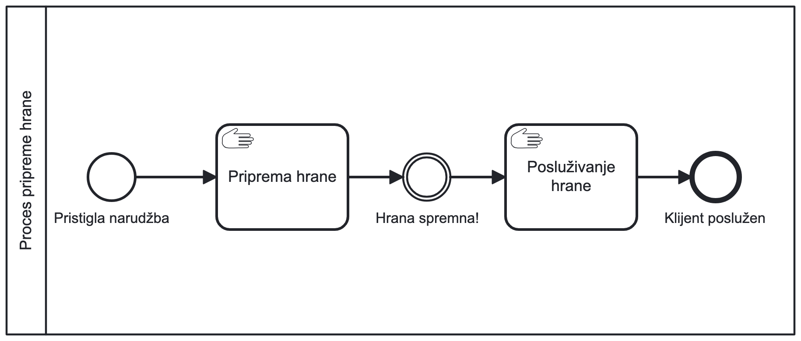</img>

> Slika 4. Primjer modeliranog procesa pripreme hrane u restoranu s _milestone_ događajem "Hrana spremna".

### Čekanje i vremenska ograničenja <!-- omit in toc -->

Koristite _Timer Intermediate Catch Event_ kada nastavak procesa ovisi o isteku određenog vremena.

_Primjer:_ Klijent naručuje hranu iz restorana preko aplikacije, a potom čeka na dovršetak. Međutim, ako prođe preko sat vremena, klijent odustaje od narudžbe.

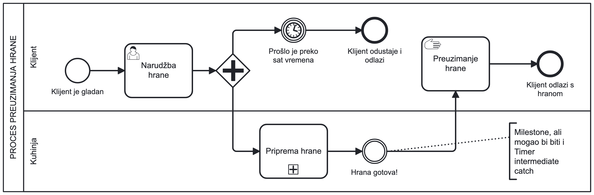</img>

> Slika 5. Primjer modeliranog procesa sa sekvencijalnim međudogađajima

U ovom primjeru koristi se paralelna skretnica (AND) te se proces dalje grana po principu: "ono što se prije dogodi".

- ili će narudžba biti gotova u roku od jednog sata pa će je klijent preuzeti
- ili će proći više od jednog sata pa će klijent odustati

**Kako znamo unaprijed vremensko razdoblje**, možemo iskoristiti _Timer Intermediate Catch Event_ za čekanje tih sat vremena ako se narudžba ne dovrši, dakle imamo specificirano vremensko razdoblje čekanja.

"Priprema hrane" je prikazana sklopljenim potprocesom koji traje neko vrijeme, a jednom kad je hrana spremna, ovisno o kontekstu, možemo definirati _milestone_ (ključnu točku) "Hrana spremna" ili "Hrana gotova!" kao _Intermediate Throw Event_. Međutim, u ovom slučaju je moguće istu stvar prikazati i s pomoću međudogađaja _Timer Intermediate Catch Event_ budući da se radi o vremenskom razdoblju potrebnom za pripremu hrane gdje nam je procijenjeno vrijeme pripreme hrane unaprijed poznato.

> Napomena: _milestone_ i ne mora biti nužno vezan uz vremensko razdoblje, već može označavati **ključnu točku u procesu**, npr. "Vremenska prognoza prikladna" → okini neki drugi proces ili nastavi slijed aktivnosti.

_Primjer: Što ako su naši klijenti djeca na nekoj rođendanskoj proslavi? Npr. želimo animirati djecu dok čekaju hranu._
Možemo dodati paralelnu aktivnost gdje zabavljamo djecu dok hrana nije gotova, a samo čekanje na spremanje hrane naglasiti kroz _Timer Intermediate Catch Event_ "Trajanje pripreme hrane". Po završetku vremenskog razdoblja proces se nastavlja.

> **Napomena**: U nastavku skripte ćemo pokazati kako ovo modelirati bolje koristeći _boundary event_.

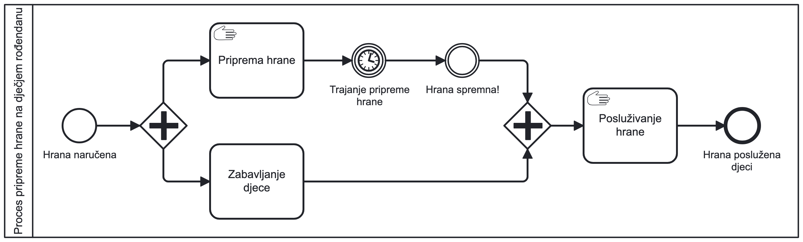</img>

> Slika 6. Primjer modeliranog procesa pripreme hrane u restoranu s paralelnom aktivnošću zabavljanja djece.

_Primjer:_ Zakomplicirat ćemo još malo stvari. Što ako nam hrana izgori i nemamo više ideja kako zabavljati djecu (primjerice prođe preko 2 sata)? U tom ćemo slučaju naručiti pizzu iz obližnje pizzerije. Komunikaciju prema pizzeriji možemo prikazati kroz _send Task_ aktivnost koja se izvršava jednom kad se okine _Timer Intermediate Catch Event_ - "Djeca izgubila strpljenje nakon 2 sata".

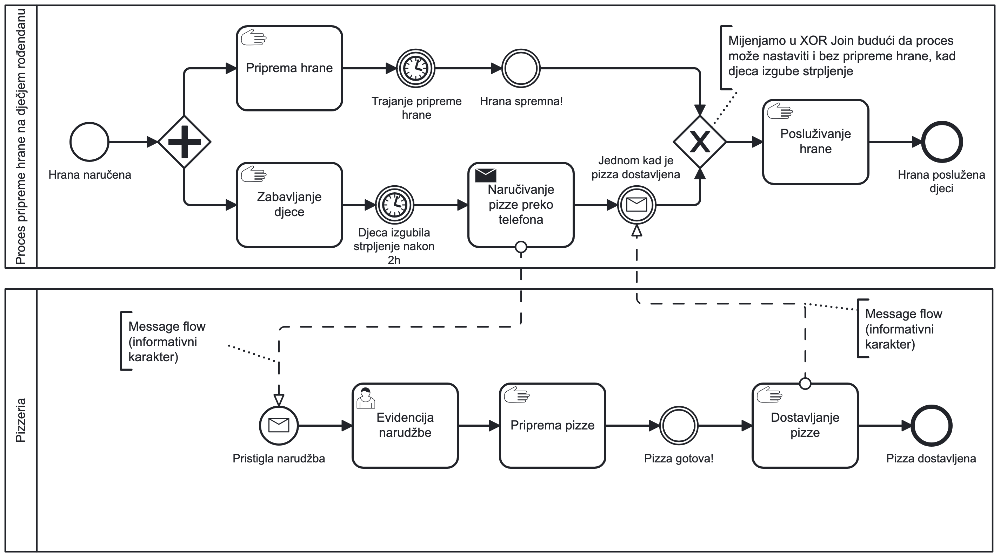</img>

> Slika 7. Primjer modeliranog procesa pripreme hrane u restoranu s paralelnom aktivnošću zabavljanja djece i narudžbom pizze nakon što djeca izgube strpljenje.

## 1.4 Slanje i zaprimanje poruka

Kao što smo već spomenuli, _Send Task_ i _Receive Task_ aktivnosti koriste se za **slanje i primanje poruka** (npr. e-pošte, SMS-a i push notifikacija) između različitih dionika ili sustava. Ove aktivnosti su **operativne radnje** koje zahtijevaju vrijeme i resurse za izvršenje.

S druge strane, _Message Intermediate Throw Event_ i _Message Intermediate Catch Event_ su **događaji** koji označavaju **trenutke u procesu** kada se poruka šalje ili prima. Ovi događaji su **pasivni elementi** koji ne zahtijevaju vrijeme ili resurse za izvršenje, već samo signaliziraju da se određeni uvjet ispunio ili stanje procesa promijenilo.

Pri modeliranju poslovnih procesa često ćemo doći u situaciju u kojoj možemo koristiti oba pristupa za prikazivanje komunikacije između procesa ili dionika. Ipak, prema BPMN smjernicama, postoje određene situacije kada je prikladnije odabrati jedan od dvaju pristupa.

U skripti UPP2 naveli smo da želimo koristiti _send/receive_ aktivnosti kod modeliranja komunikacija između dva entiteta odnosno polja, npr. između **Kupca** i **Veleprodaje** ili između **Veleprodaje** i **Skladišta**. Pritom je važno kako ćemo imenovati ove aktivnosti. Ukratko, moramo se pridržavati smjernica za imenovanje aktivnosti koje smo ranije naveli.

### Primjer bankovnog izvoda <!-- omit in toc -->

_Primjer:_ Komunikacija između polja BANKA i KLIJENT gdje klijent šalje zahtjev za bankovni izvod. Banka priprema izvod i šalje ga klijentu koristeći _send_ aktivnost **što je u redu**, ali pogreška je u imenovanju te aktivnosti: "Priprema bankovnog izvoda za slanje klijentu". Nije naglašeno da se radi o slanju poruke, već o pripremi izvoda. Osim toga, želimo imenovati aktivnosti na način da budu **elementarne radne jedinice** - prisjetite se prve skripte gdje smo rekli da aktivnosti još nazivamo i **radnim koracima**.

Drugim riječima, aktivnost treba jasno opisivati **što se radi** u toj aktivnosti, a ne kombinirati više radnji u jednoj aktivnosti.

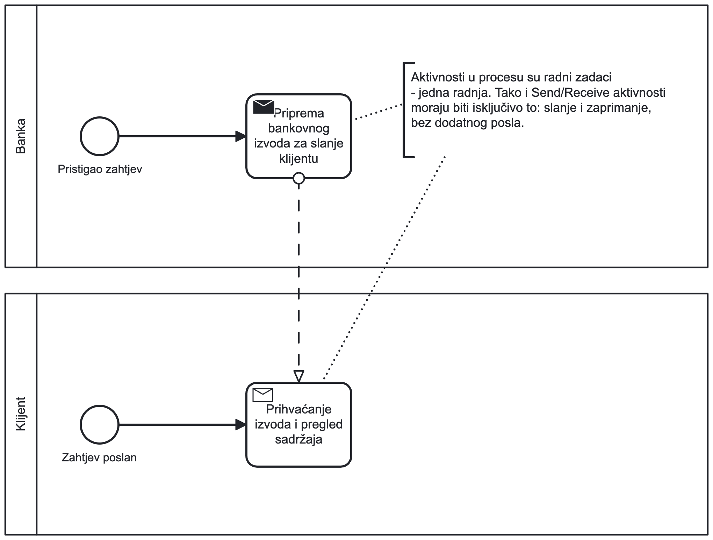</img>

> Slika 8. Primjer **neispravnog imenovanja** _Send/Receive Task_ aktivnosti (_send task_ ne naglašava da se radi o slanju izvoda, već o pripremi istog). _Receive task_ naglašava i zaprimanje i pregled sadržaja, što bi bilo bolje podijeliti u dvije aktivnosti.

- ✅ **Razmjena poruka.** _Send Task_ i _Receive Task_ prikladni su za komunikaciju između banke i klijenta.
- 🔧 **Priprema i slanje izvoda.** Naziv „Priprema bankovnog izvoda za slanje klijentu” naglašava pripremu. Prikažite pripremu i slanje kao dva koraka.
- 🔧 **Primitak i pregled izvoda.** Razdvojite trenutak primitka izvoda, koji možete prikazati međudogađajem, i aktivnost pregleda sadržaja.

Podijelit ćemo ove složene _send/receive_ aktivnosti u dva elementarnija radna zadatka:

1. "Priprema bankovnog izvoda" (_service task_) → "Slanje bankovnog izvoda" (_send task_)
2. "Prijem bankovnog izvoda" (_receive task_) → "Pregled sadržaja izvoda" (_user task_)

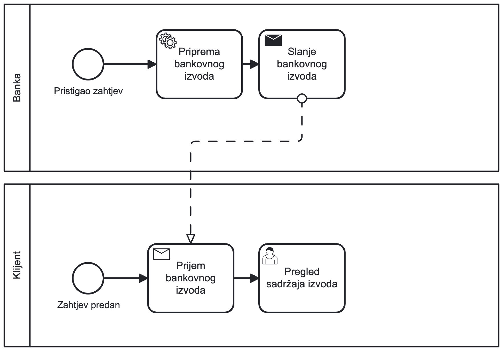</img>

> Slika 9. Ispravno modeliranje komunikacije između dvaju entiteta s pomoću _Send/Receive_ aktivnosti s ispravnim imenovanjem i podjelom u elementarnije radne zadatke.

- ✅ **Jasni radni koraci.** Priprema, slanje, primitak i pregled izvoda prikazani su kao zasebne aktivnosti s konkretnim nazivima.
- 🔧 **Trenutak primitka.** Ako želite naglasiti kada je izvod stigao, odaberite _Message Intermediate Catch Event_.

Pitanje: Možemo li ovo modelirati koristeći _Message Intermediate Throw/Catch Event_ umjesto _Send/Receive Task_ aktivnosti? Odgovor je da, i to smo do sada i radili. Međutim, **važno je ispravno imenovati te događaje prema smjernicama za imenovanje događaja** koje smo ranije naveli.

Pretvorit ćemo _send/receive_ aktivnosti u _message intermediate throw/catch event_ događaje i **izmijeniti njihove nazive prema smjernicama za imenovanje događaja**.

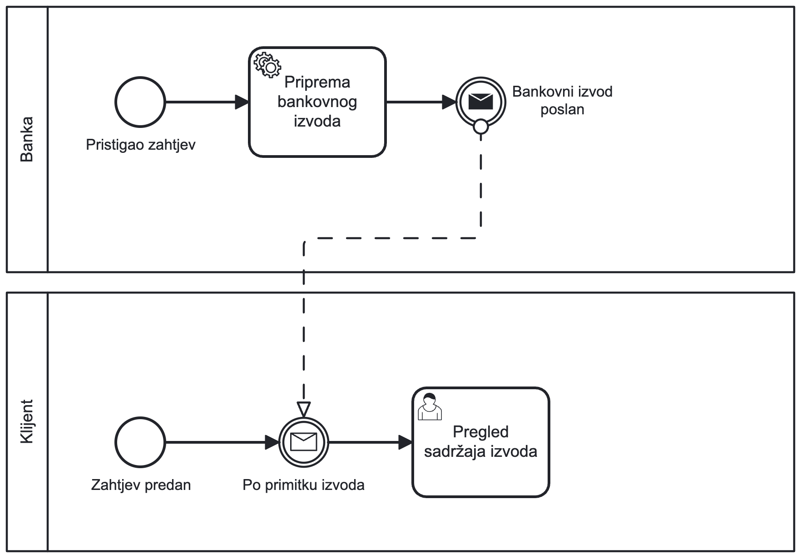</img>

> Slika 10. Primjer modeliranja komunikacije između dvaju entiteta s pomoću _Message Intermediate Throw/Catch Event_ međudogađaja s ispravnim imenovanjem.

- ✅ **Primitak izvoda.** Međudogađaj označava trenutak kada je izvod stigao. Pregled sadržaja prikazan je kao zasebna aktivnost.
- 🔧 **Slanje izvoda.** Ako djelatnik banke šalje izvod, prikažite „Slanje bankovnog izvoda” kao _Send Task_. Ako izvod šalje sustav i želite istaknuti trenutak slanja, upotrijebite _Message Intermediate Throw Event_ „Bankovni izvod poslan”.

> Oba su prikaza sintaktički ispravna. Odabir ovisi o poslovnom kontekstu.

### Primjer zahtjeva za kredit <!-- omit in toc -->

Ipak, **u praksi se često kombiniraju oba pristupa** ovisno o kontekstu poslovne logike koja se modelira.

_Primjer_: Klijent predaje zahtjev za mali kredit u banci. Banka obrađuje zahtjev nekoliko dana, a zatim šalje odluku klijentu. Banka prvo šalje klijentu obavijest da je zahtjev zaprimljen, a nakon obrade (složenog potprocesa) šalje konačnu odluku i popratnu dokumentaciju. Navedeno možemo modelirati kombiniranjem _send/receive_ aktivnosti i _message intermediate throw/catch event_ međudogađaja kako bismo jasno definirali ključne trenutke u ovom procesu.

Iz ovog primjera najvažnije je uočiti **kako su aktivnosti/događaji imenovani** prema smjernicama za imenovanje aktivnosti i događaja te kako smo odabrali ispravan objekt toka (aktivnost ili događaj) ovisno o kontekstu poslovne logike.

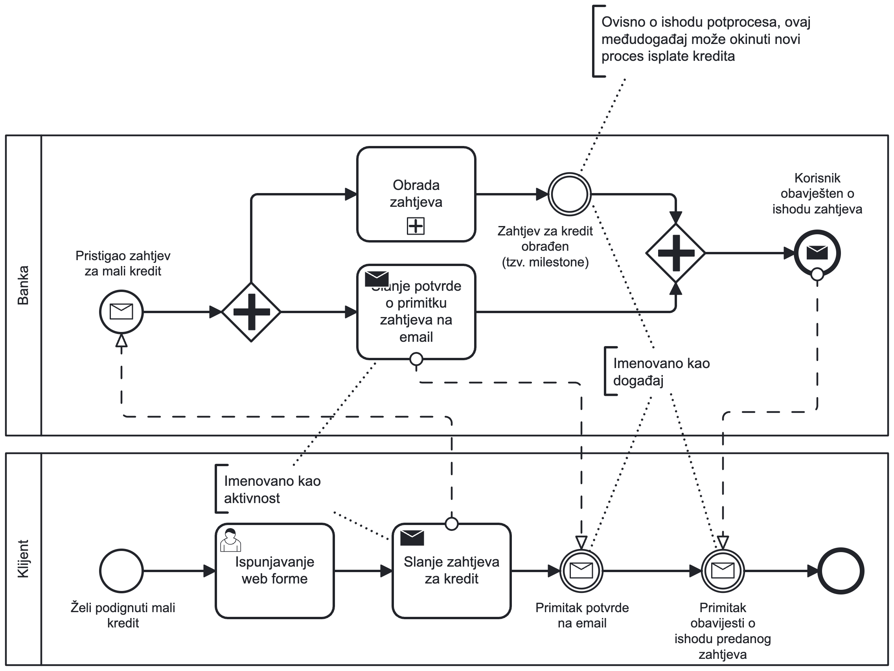</img>

> Slika 11. Primjer modeliranja procesa predaje zahtjeva za kredit s pomoću kombinacije _Send/Receive Task_ aktivnosti i _Message Intermediate Throw/Catch Event_ međudogađaja s ispravnim imenovanjem. [BPMN model](models/diagram_20.bpmn)

- ✅ **Slanje zahtjeva za kredit.** _Send Task_ prikazuje radnju slanja koja zahtijeva vrijeme i resurse.
- ✅ **Primitak potvrde i obavijesti o ishodu.** Dva _Message Intermediate Catch Event_ međudogađaja označavaju trenutke kada poruke stižu.
- ✅ **„Zahtjev za kredit obrađen”.** _Intermediate Throw Event_ označava ključnu točku u procesu. Uvrstite ga ako je važan za čitanje modela.
- 🔧 **Slanje potvrde e-poštom.** Za radnju djelatnika banke prikladan je _Send Task_. Ako potvrdu automatski šalje sustav i želite istaknuti trenutak slanja, upotrijebite _Message Intermediate Throw Event_ „Potvrda o primitku zahtjeva poslana”.

> Napomena: Te nijanse ovise o kontekstu poslovne logike koja se modelira. Pri izradi aplikacija usmjerenih na poslovne procese (_business-process-oriented_) postaju važnije zbog načina na koji se proces izvršava.

### Smjernice za odabir aktivnosti i događaja <!-- omit in toc -->

1. Koristite _Send Task_ kada slanje poruke (npr. e-poštom ili SMS-om) zahtijeva vrijeme i resurse, primjerice kada poruku šalje djelatnik.
2. Koristite _Receive Task_ za obradu poruka koje dolaze od dionika procesa (_Receive Task_ je zapravo ekvivalentna kratica za _Message Intermediate Catch Event_ i popratnu aktivnost).
3. Koristite _Message Intermediate Throw Event_ za signalizaciju drugim procesima da nešto učine (okidanje drugih procesa) slanjem poruke/signala/notifikacije.
4. Koristite _Message Intermediate Catch Event_ za hvatanje signala ili poruka od drugih procesa (okidanje procesa ili nastavak procesa) bez potrebe za ljudskom intervencijom.

_Receive Task_ je nešto rjeđa aktivnost u BPMN modeliranju, međutim ima svoju svrhu. Radi se o kratici (skraćenici) koja kombinira dva BPMN elementa: _Message Intermediate Catch event_ i neku popratnu aktivnost - najčešće obradu dobivenog signala/poruke. Dakle, _Receive Task_ predstavlja aktivnost koja čeka na primitak poruke ili signala od drugog entiteta prije nego što nastavi s obradom te poruke/signala.

_Primjer:_ "Obrada zaprimljene narudžbe" može biti modelirana kao `Receive Task` koja čeka na primitak narudžbe od kupca (trenutak) i njenu obradu (aktivnost).

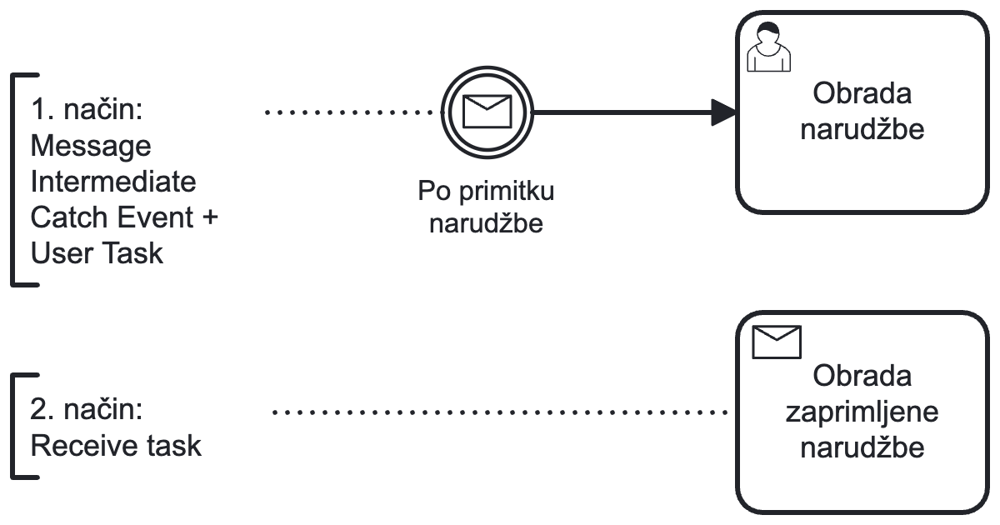</img>

> Slika 12. Ponekad je korisno koristiti `Receive Task` za modeliranje aktivnosti koja uključuje primitak poruke ili signala te popratnu aktivnost obrade iste.

## 1.5 Komunikacija između polja i staza

**Informacijski tok** (_Message Flow_) prikazuje komunikaciju između sudionika u različitim poljima.

**Sekvencijalni tok** (_Sequence Flow_) povezuje korake istog procesa, uključujući korake u različitim stazama.

### Naručivanje hrane i priprema u zasebnim poljima <!-- omit in toc -->

Primjer naručivanja hrane iz [odjeljka 1.3](#13-ključne-točke-i-čekanje-u-procesu) možemo proširiti prikazom komunikacije između klijenta i restorana.

Vanjske procese uobičajeno je okinuti pomoću _Send Task_ aktivnosti ili _Message Intermediate Throw Event_ međudogađaja.

Informacijski tok crta se isprekidanom strelicom i prikazuje razmjenu poruka između sudionika.

> Napomena: Prema specifikaciji BPMN 2.0 informacijski tok nije nužno navoditi između dva objekta, ali je poželjno radi jasnije komunikacije i razumijevanja modela.

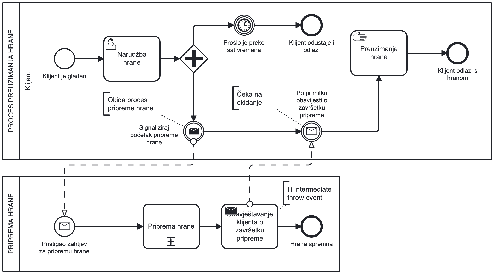</img>

> Slika 13. Primjer modeliranog procesa u dva polja. Paralelnim grananjem se istovremeno signalizira početak procesa PRIPREMA HRANE te započinje _timer_ od sat vremena nakon čega klijent odustaje od narudžbe.

U gornjem je primjeru prikladno koristiti _Send Task_ aktivnost za signalizaciju aktivacije međudogađaja "Primanje obavijesti o završetku pripreme" budući da se radi o slanju nekog oblika poruke. Da to nije slučaj, prikladnije bi bilo koristiti generalni _Intermediate Throw Event_ te definirati _milestone_, npr. "Hrana spremna", što opet implicira okidanje drugog procesa.

> Zapamti: _Send Task_/_Message Intermediate throw event_ implicira slanje poruke (npr. e-pošte, SMS-a i _realtime push_ notifikacija), dok _Intermediate Throw Event_ može signalizirati i bez slanja poruke (npr. okidanje nekog drugog procesa drugim mehanizmom ili računalnim protokolom, ali i _offline_ komunikacijom poput fizičke dostave dokumenta).

### Veleprodaja i vanjsko skladište <!-- omit in toc -->

Veleprodaju predstavljamo kao zasebni proces u zasebnom polju (VELEPRODAJA - PROCES NARUČIVANJA ROBE). Proces započinje kad veleprodaja zaprimi narudžbu. Veleprodaja provjerava stanje zaliha. Ako robe nedostaje, kontaktira skladište kako bi provjerila dostupnost robe i naručila potrebnu količinu. Roba se dostavlja veleprodaji svakog ponedjeljka.

Skladište u ovom kontekstu je _outsourcani_ partner čiji ćemo proces nazvati OTPREMA ROBE.

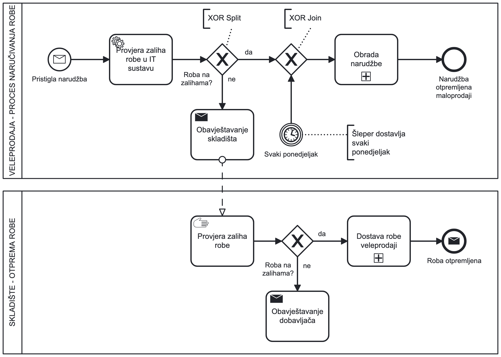</img>

> Slika 14. Primjer modeliranih procesa naručivanja i otpreme robe s pogrešnom komunikacijom između dva polja/procesa. Drugi proces (SKLADIŠTE - OTPREMA ROBE) nema početni događaj.

- ✅ **Poruka vanjskom skladištu.** Veleprodaja pomoću _Send Task_ aktivnosti šalje obavijest o nedostatku robe.
- ❌ **Početak otpreme.** U zasebnom polju skladišta nedostaje početni događaj. Početnim i završnim događajem označite granice svakog prikazanog procesa ili potprocesa.

Jednostavno ćemo dodati početni događaj u polje SKLADIŠTE - OTPREMA ROBE.

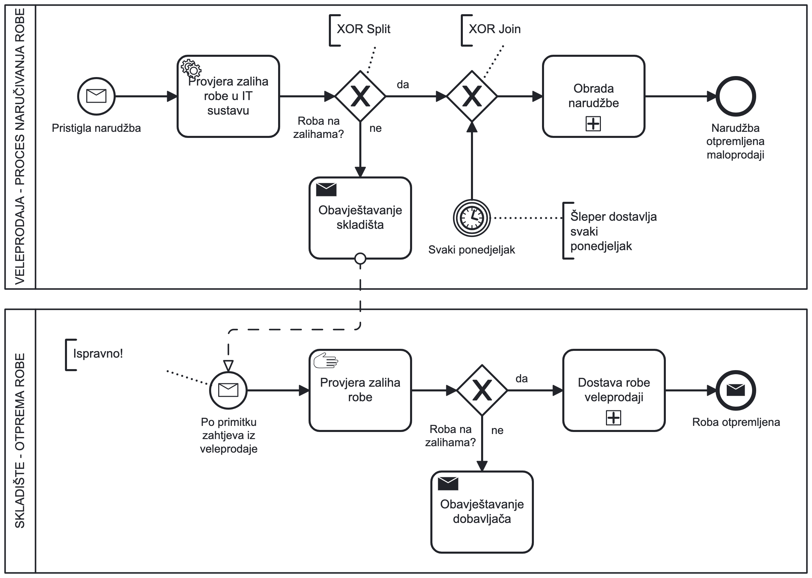</img>

> Slika 15. Primjer modeliranih procesa naručivanja i otpreme robe s ispravnom komunikacijom između dva polja/procesa. Drugi proces (SKLADIŠTE - OTPREMA ROBE) sada ima početni događaj.

### Veleprodaja i interno skladište <!-- omit in toc -->

Međutim, što ako se radi o internom skladištu koje je dio iste veleprodaje? U tom slučaju komunikaciju **ne želimo modelirati kao slanje poruke** (prisjetimo se e-pošte, SMS-a i sl.). Dakle, možemo maknuti _send Task_ aktivnost i samo nastaviti sekvencijalni tok prema sljedećoj aktivnosti.

Zašto? Vjerojatno provjeravamo dostupnost robe u internom skladištu putem istog IT sustava, ERP-a ili jednostavno fizički odlazimo i provjeravamo stanje. U tom slučaju **_send/receive_ aktivnosti su nam redundantne** i samo **nepotrebno kompliciraju model**.

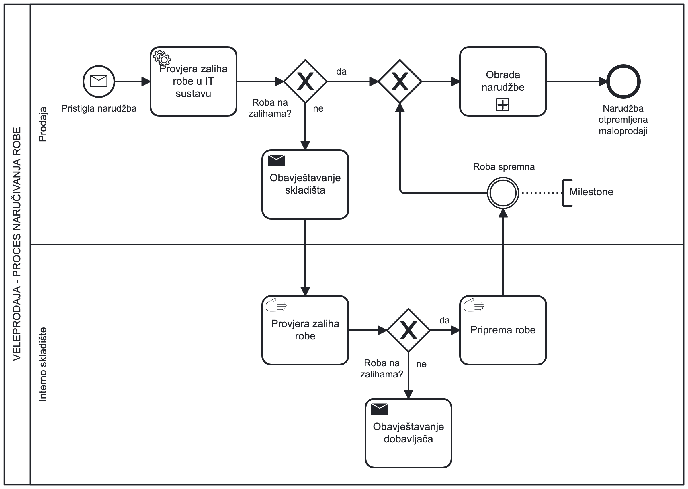</img>

> Slika 16. Primjer modeliranog procesa VELEPRODAJA - PROCES NARUČIVANJA ROBE s redundantnom komunikacijom unutar istog polja - između dvije staze.

- ✅ **Priprema robe u internom skladištu.** Uklonjen je _Timer Intermediate Catch Event_ „Svaki ponedjeljak”. Međudogađaj „Roba spremna” može označiti trenutak kada se proces nastavlja prema XOR spajanju.
- ❌ **Suvišan _Send Task_.** Dostupnost robe provjerava se unutar istog procesa. Sekvencijalni tok može izravno voditi do provjere zaliha u stazi internog skladišta.

Možemo jednostavno ukloniti _Send Task_ aktivnost i samo nastaviti sekvencijalni tok prema sljedećoj aktivnosti "Provjera zaliha robe" u stazi internog skladišta.

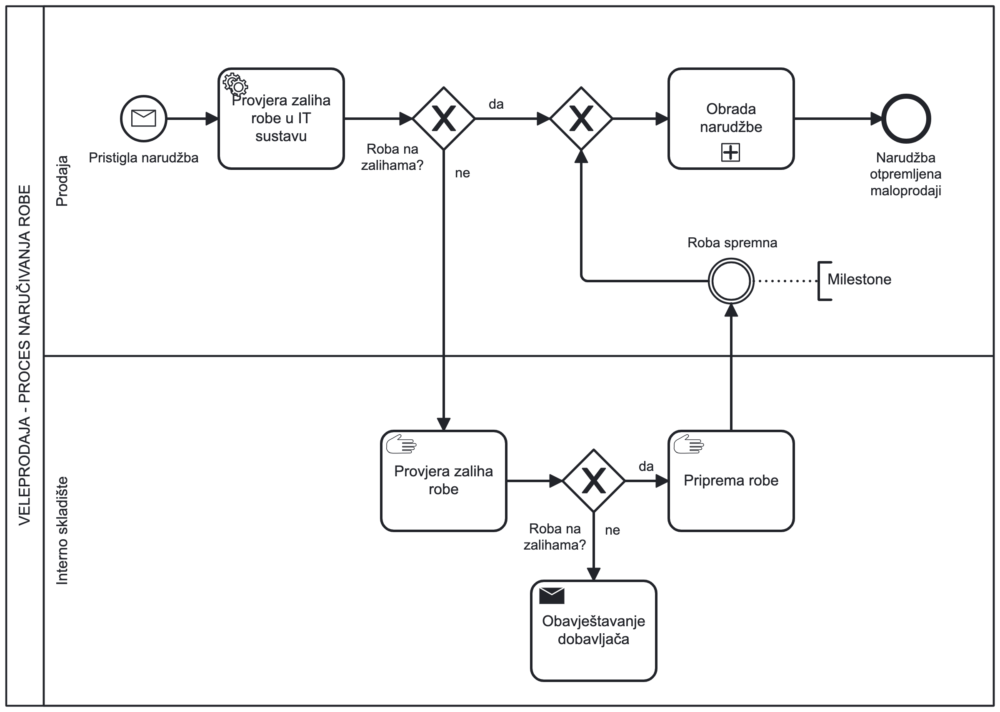</img>

> Slika 17. Primjer modeliranog procesa VELEPRODAJA - PROCES NARUČIVANJA ROBE bez redundantne komunikacije unutar istog polja - između dvije staze.

### Dodatna narudžba vanjskom skladištu <!-- omit in toc -->

Razmotrimo ponovno scenarij s eksternim skladištem. Što se događa ako se, nakon dolaska šlepera s robom, pojavi potreba za dodatnom narudžbom robe?

_Primjer poslovnog slučaja:_ maloprodaja šalje narudžbu veleprodaji. Veleprodaja naručuje robu od eksternog skladišta svakog ponedjeljka te je proces SKLADIŠTE - OTPREMA ROBE instanciran. Međutim, nakon što šleper stigne s robom, maloprodaja šalje dodatnu narudžbu veleprodaji (npr. zbog neočekivane potražnje). Tada se već aktivni proces VELEPRODAJA - PROCES NARUČIVANJA ROBE mora na neki način **ponovno okinuti** kako bi se obradila nova narudžba, a samim time i proces SKLADIŠTE - OTPREMA ROBE ako je potrebno.

Kako bismo cijeli proces učinili jasnijim i preglednijim, možemo ga modelirati **korištenjem međudogađaja** _Message Intermediate Throw Event_ i _Message Intermediate Catch Event_ kako bismo bolje naglasili navedene ključne trenutke u procesu:

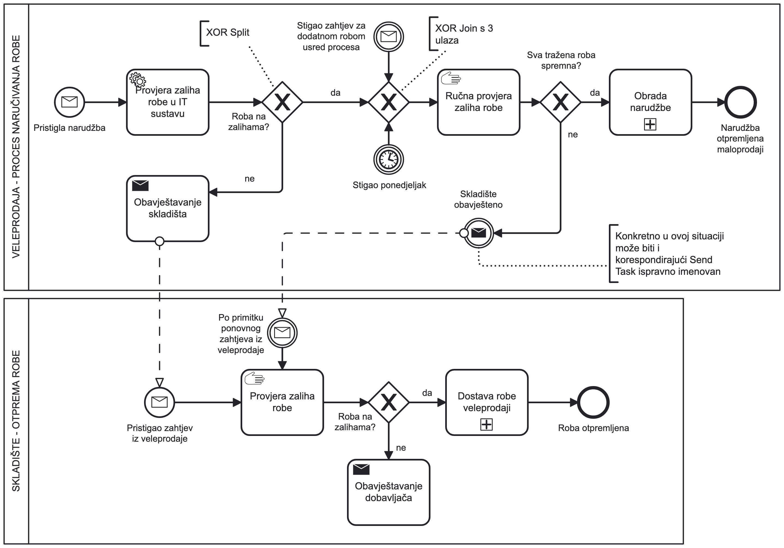</img>

> Slika 18. Primjer modeliranog procesa VELEPRODAJA - PROCES NARUČIVANJA ROBE s ispravnom komunikacijom između dva polja/procesa s pomoću međudogađaja za signalizaciju potrebe za dodatnom narudžbom robe.

- ✅ **Ispravno**: U ovom slučaju koristimo _Message Intermediate Throw Event_ za signalizaciju potrebe za dodatnom narudžbom robe. Kada se dogodi taj međudogađaj, ponovno se stvara instanca procesa VELEPRODAJA - PROCES NARUČIVANJA ROBE. Koristimo korespondirajući _Message Intermediate Catch Event_ za hvatanje tog signala i pokretanje procesa SKLADIŠTE - OTPREMA ROBE.
- ✅ **Ispravno**: Definirali smo i _Message Intermediate Catch Event_ "Stigao zahtjev za dodatnu robu usred procesa" kako bismo jasno definirali trenutak kad se za vrijeme trajanja procesa VELEPRODAJA - PROCES NARUČIVANJA ROBE pojavila potreba za dodatnom narudžbom robe. Potreba se pojavila usred procesa, dok se čeka na dolazak šlepera s prvotnom narudžbom - XOR merge će nastaviti prvim dolaznim signalom.

## 1.6 Entiteti na informacijskim tokovima (_eng. Message Flow Entities_)

Uobičajeno je dodati entitete na informacijskim tokovima kako bi se dodatno pojasnila komunikacija između objekata. U primjeru narudžbe pizze iz [odjeljka 1.3](#13-ključne-točke-i-čekanje-u-procesu) možemo dodati entitet "Narudžba" na informacijskom toku između _send taska_ "Naručivanje pizze preko telefona" i _message start eventa_ "Pristigla narudžba" kako bismo naglasili da je poruka koja se šalje upravo **narudžba s detaljima o naručenim pizzama**.

Jednako tako, između aktivnosti _Manual Task_ naziva "Dostavljanje pizze" i međudogađaja _Message Intermediate Catch Event_ naziva "Jednom kad je pizza dostavljena" možemo dodati entitet "Naručene pizze i račun" kako bismo naglasili što se dostavlja tim informacijskim tokom.

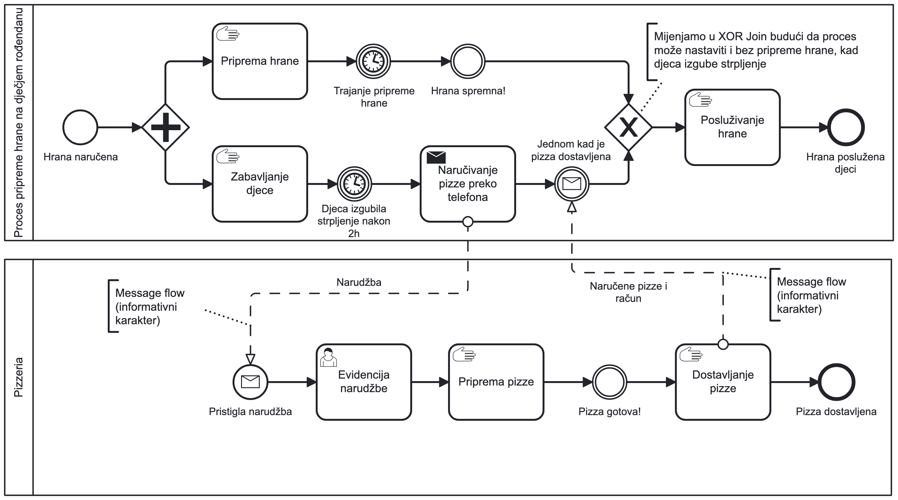</img>

> Slika 19. Primjer modeliranog procesa pripreme hrane u restoranu s paralelnom aktivnošću zabavljanja djece i narudžbom pizze nakon što djeca izgube strpljenje, uz dodatne entitete na informacijskim tokovima.

**Entiteti** na informacijskom toku su korisni jer:

- **pojašnjavaju** što se šalje između objekata
- **jasno definiraju** što se očekuje od poruke/signala
- **poboljšavaju čitljivost** i **razumijevanje** modela procesa

Ilustracija ispod prikazuje komunikaciju između PRODAVATELJA i KUPCA te različite entitete koji se šalju između njih, a koje definiramo na informacijskim tokovima.

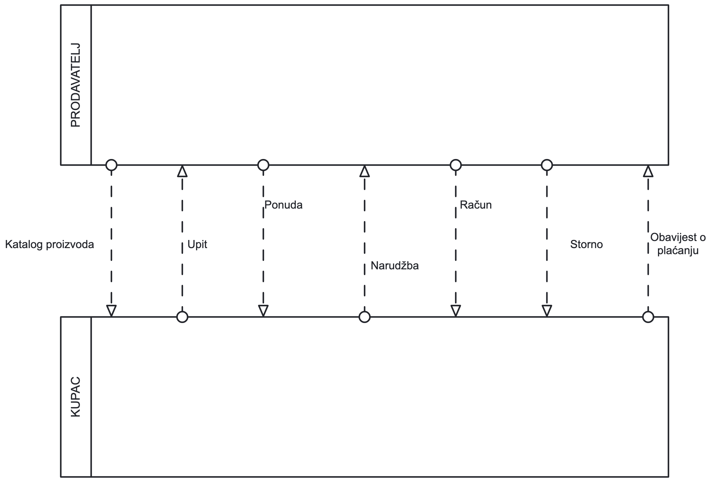</img>

> Slika 20. Informacijske tokove možemo dodatno pojasniti definiranjem entiteta koji se šalju između BPMN objekata.

> Napomena: **Entitete možemo dodati i na sekvencijalnim tokovima**, premda je to manje uobičajeno. Entiteti na sekvencijalnim tokovima mogu biti korisni kada želimo naglasiti što se prenosi između aktivnosti, npr. koji su ulazni podaci u određenu aktivnost i/ili koji su izlazni podaci nakon izvršenja aktivnosti. Prisjetite se procesa produljenja registracije motornog vozila iz skripte UPP3 gdje smo dodavali entitete na sekvencijalne tokove kako bismo naglasili koji se dokumenti i/ili podaci prenose između aktivnosti.

# 2. Boundary event (Međudogađaji na aktivnostima)

U BPMN modeliranju _boundary event_ (međudogađaj na aktivnosti) je poseban tip događaja koji je vezan za određenu aktivnost i koristi se za hvatanje (_engl. catch_) određenih eskalacija, signala, poruka ili vremenskih okidača koji se mogu dogoditi tijekom izvođenja te aktivnosti.

U literaturi o BPMN-u na hrvatskom jeziku _boundary event_ se često prevodi kao _međudogađaj na aktivnosti_ ili **rubni događaj**. U nastavku ove skripte koristit ćemo termin _boundary event_.

_Boundary eventi_ su korisni za modeliranje iznimnih situacija ili uvjeta koji mogu utjecati na tijek procesa, **a ne zahtijevaju prekid same aktivnosti**.

_Boundary eventi_ se prikazuju krugovima s dvostrukim, koncentričnim kružnicama (identično kao međudogađaji), ali su **priključeni na rub aktivnosti** - zato se nazivaju _boundary event_ (međudogađaj na aktivnosti).

  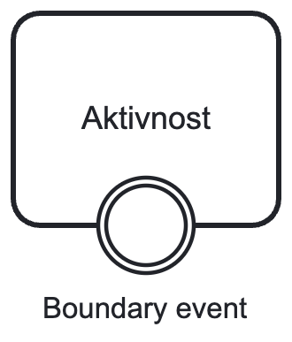
  <code>Boundary event</code> (priključen na aktivnost)

Prema Camunda 8 BPMN specifikaciji, postoji više različitih tipova _boundary eventa_, od kojih se većina koristi prilikom razvoja procesne aplikacije. Međutim, u kontekstu modeliranja poslovnih procesa, koristi se samo nekolicina njih.

Postoje 2 glavna tipa _boundary eventa_:

1. **Interrupting boundary event** (prekidajući _boundary_ međudogađaj) - kada se dogodi ovaj _boundary_ događaj, **prekida se aktivnost za koju je događaj vezan**, a tijek procesa nastavlja se prema izlaznoj putanji definiranoj za taj _boundary_ događaj.
2. **Non-interrupting boundary event** (neprekidajući _boundary_ međudogađaj) - kada se dogodi ovaj _boundary_ događaj, **aktivnost za koju je događaj vezan nastavlja se izvoditi**, a paralelno se izvršava slijed definiran izlaznom putanjom tog događaja.

Prema BPMN specifikaciji, zadani tip _boundary eventa_ je **interrupting** (prekidajući), a prikazuje se neisprekidanim kružnicama (kao na slici iznad - jednako međudogađaju). Ako želimo definirati **non-interrupting** (neprekidajući) _boundary event_, tada se koristi isprekidana linija za kružnice.

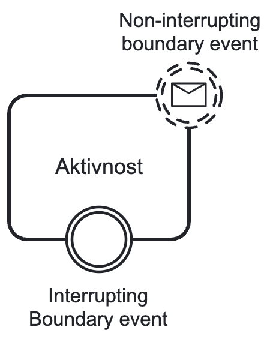</img>

> Slika 21. Interrupting (prekidajući) _boundary event_ prikazan neisprekidanim kružnicama (jednako kao klasičan međudogađaj). Non-interrupting (neprekidajući) _boundary event_ prikazan isprekidanim kružnicama.

Za početak, pokazat ćemo kada koristiti _boundary event_ na procesu POLAGATI ISPIT koji se sastoji od staza PROFESOR i UČENIK.

_Primjer_: Učenik polaže ispit koji traje određeno vremensko razdoblje (npr. 30 minuta). Slijed aktivnosti u stazi UČENIK obuhvaća aktivnosti "Rješavati zadatke" i "Predati završeni ispit". Predajom ispita završava učenikov ispitni proces čak i ako preda zadaću prije isteka vremena. Međutim, ako istekne vrijeme i učenik nije predao zadaću, **aktivnost "Rješavati zadatke" se mora prekinuti**, profesor sakuplja zadaću i ocjenjuje je.

Za boldani dio teksta - prekidanje aktivnosti "Rješavati zadatke" - koristit ćemo _interrupting timer boundary event_ vezan za tu aktivnost.

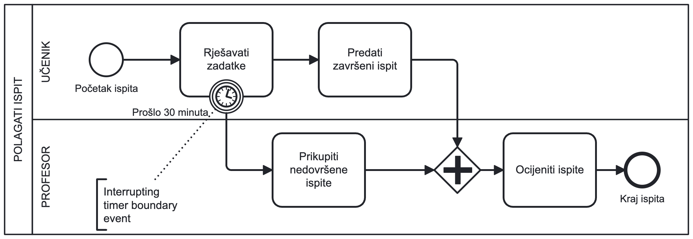</img>

> Slika 22. Primjer modeliranog procesa POLAGATI ISPIT s _interrupting timer boundary eventom_ vezanim za aktivnost "Rješavati zadatke".

Do sada bismo ovakve situacije modelirali jednostavnim _timer intermediate catch eventom_ koji bismo paralelno granali s aktivnošću "Rješavati zadatke" po principu "što se prije dogodi". Međutim, korištenjem _boundary eventa_ jasno naglašavamo da je vremensko ograničenje **izravno povezano s aktivnošću** "Rješavati zadatke" te da se ta aktivnost mora prekinuti kada istekne vrijeme.

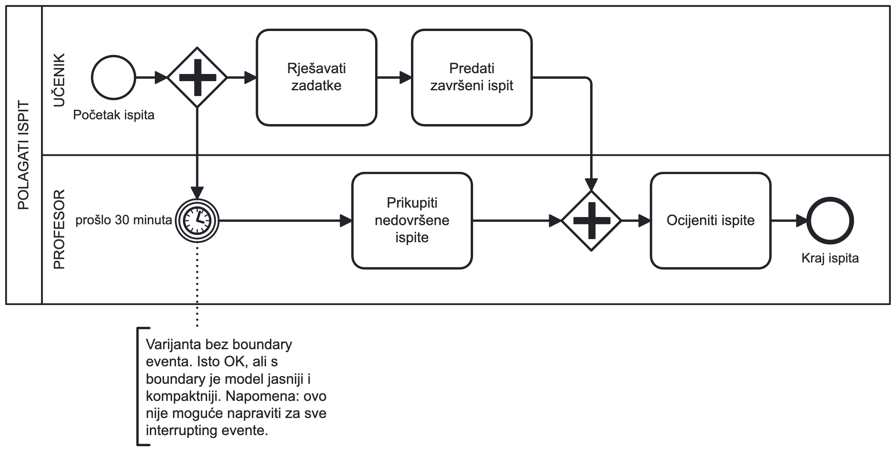</img>

> Slika 23. Primjer modeliranog procesa POLAGATI ISPIT s paralelnim _timer intermediate catch eventom_ koji nije vezan za aktivnost "Rješavati zadatke". Isto ispravno, ali model je teži za čitanje, a i može doći do zabune jer nije jasno da je vremensko ograničenje izravno povezano s aktivnošću "Rješavati zadatke".

## 2.1 Vrste interrupting boundary eventa

Slično kao kod standardnih međudogađaja, i _boundary eventi_ dolaze u različitim varijantama ovisno o vrsti okidača koji hvataju. Generalni _interrupting boundary event_ može se koristiti za hvatanje različitih vrsta eskalacija, signala ili poruka **koje mogu prekinuti aktivnost na koju je vezan**.

U nastavku su prikazane najčešće korištene vrste _interrupting boundary eventa_ u kontekstu modeliranja poslovnih procesa:

  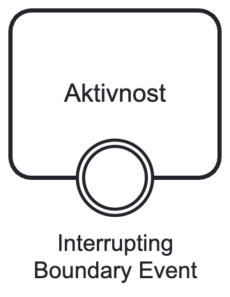
  <code>Interrupting Boundary Event</code> <b> (prekidajući boundary događaj)</b>  generalni prekidajući međudogađaj koji se može koristiti za hvatanje različitih vrsta eskalacija, signala ili poruka koje mogu prekinuti aktivnost na koju je vezan. Zamislimo ga kao <i>milestone</i> međudogađaj koji se odnosi na aktivnost. Kada nastupi taj događaj, aktivnost se prekida.

_Primjeri imenovanja:_ "Hrana djelomično gotova", "Dio namirnica nedostaje", "Javljanje osobe s većim prioritetom"...

  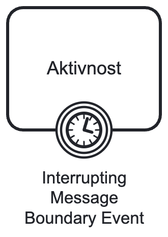
  <code>Interrupting Timer Boundary Event</code> <b>(prekidajući vremenski boundary događaj)</b>  koristi se za prekidanje aktivnosti nakon određenog vremenskog razdoblja ili u određenom specificiranom vremenskom trenutku. Zamislimo ga kao <b>alarm koji se postavlja na aktivnost</b>. Kada istekne zadano vrijeme, aktivnost se prekida.

_Primjeri imenovanja_: "Isteklo vrijeme za rješavanje zadataka", "Rok za dostavu dokumentacije je prošao", "Prošlo je više od 24 sata"...

  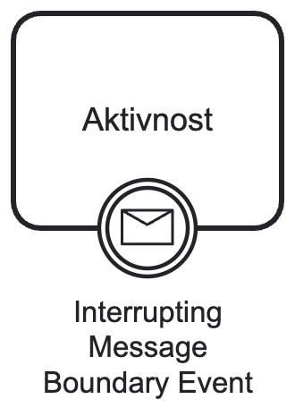
  <code>Interrupting Message Boundary Event</code> <b>(prekidajući obavještajni boundary event)</b>  koristi se za hvatanje dolaznih poruka koje mogu prekinuti aktivnost. Zamislimo ga kao <b>signal koji prekida aktivnost</b> kada stigne određena poruka.

_Primjeri imenovanja_: "Otkaži/storniraj narudžbu", "Hitno zaustavi izvođenje", "Stigao zahtjev za promjenu", "primljeni podaci vanjske analize ..." itd.

  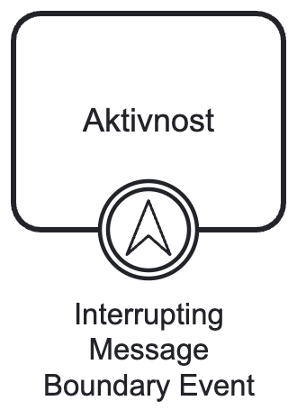
  <code>Interrupting Escalation Boundary Event</code> <b>(prekidajući eskalacijski boundary event)</b>  koristi se za hvatanje eskalacija koje mogu prekinuti aktivnost. Eskalacije se obično koriste za označavanje situacija koje zahtijevaju hitnu pažnju ili intervenciju. Zamislimo ga kao <b>signal upozorenja koji prekida aktivnost</b> kada se dogodi eskalacija. Ovo je podskup generalnog <i>interrupting boundary eventa</i>.

_Primjeri imenovanja_: "Rizik premašio dopušteni prag", "Kritični resurs nedostupan", "Rezultat nije vjerodostojan", "Projekt kasni"...

  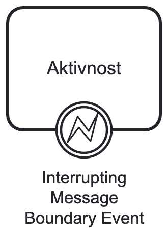
  <code>Interrupting Error Boundary Event</code> <b>(prekidajući boundary event greške)</b>  koristi se za hvatanje grešaka koje mogu prekinuti aktivnost. Zamislimo ga kao <b>signal greške koji prekida aktivnost</b> kada se dogodi greška. Ovo je podskup generalnog <i>interrupting boundary eventa</i>.

_Primjeri imenovanja_: "Greška u sustavu", "Neuspjela validacija podataka", "Pogrešan unos korisnika"

> Napomena: Postoji još vrsta _interrupting boundary eventa_ (npr. _cancel boundary event_, _compensation boundary event_, _signal boundary event_), ali se oni rjeđe koriste u kontekstu modeliranja poslovnih procesa, pa ih nećemo detaljnije razmatrati u ovoj skripti.

Varijante _Timer_ i _Message_ prekidajućeg rubnog događaja poznatije su nam budući da se ponašaju jednako kao i njihovi ekvivalenti među standardnim međudogađajima na sekvencijalnom slijedu. Međutim, sada su izravno vezane uz aktivnost i mogu je **prekinuti usred njezina izvođenja**.

_Escalation boundary event_ koristi se za hvatanje raznih eskalacija koje mogu prekinuti aktivnosti.

_Primjer:_ Na modeliranom procesu "Organizacija koncerta u Pulskoj Areni" u rješenjima iz vježbi UPP3, upotrijebljen je _escalation boundary event_ vezan za aktivnost "Monitoring prodaje ulaznica" koji hvata eskalaciju "Slaba prodaja!". Međutim, nismo detaljnije razmatrali njegovo značenje. Sada znamo da se radi o _interrupting escalation boundary eventu_ koji bi zapravo prekinuo navedenu aktivnost kada se dogodi eskalacija, pa je u tom slučaju točnije koristiti varijantu _non-interrupting escalation boundary event_. Više u nastavku...

U istom poslovnom procesu korišten je i _interrupting timer boundary event_ na aktivnosti "Prodaja ulaznica preko weba" koji hvata eskalaciju "Sve do dana koncerta ili rasprodanosti ulaznica!". Ovdje je ispravno korišten _interrupting timer boundary event_ jer kada se dogodi eskalacija (pristiže dan koncerta), aktivnost se mora prekinuti. Međutim, za rasprodanost ulaznica je bolje koristiti _interrupting boundary event_.

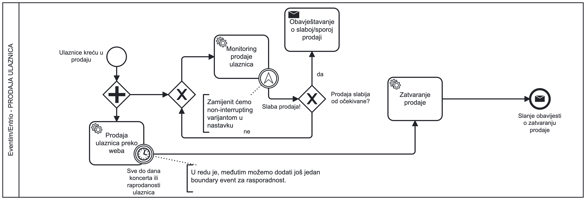</img>

> Slika 24. Isječak iz procesa "Organizacija koncerta u Pulskoj Areni" s korištenim _boundary eventima_.

| ✅ Ispravno                                                                                                                                                                                                                                           | ❌ Manje ispravno                                                                                                                                                                                                                                                                                                                                                                                                                                                                                                                                            |
| ----------------------------------------------------------------------------------------------------------------------------------------------------------------------------------------------------------------------------------------------------- | ------------------------------------------------------------------------------------------------------------------------------------------------------------------------------------------------------------------------------------------------------------------------------------------------------------------------------------------------------------------------------------------------------------------------------------------------------------------------------------------------------------------------------------------------------------ |
| Korišten je _interrupting timer boundary event_ na aktivnosti "Prodaja ulaznica preko weba" koji hvata eskalaciju "Sve do dana koncerta ili rasprodanosti ulaznica!". Kada se dogodi eskalacija (pristiže dan koncerta), aktivnost se mora prekinuti. | Korišten je _interrupting escalation boundary event_ na aktivnosti "Monitoring prodaje ulaznica" koji hvata eskalaciju "Slaba prodaja!". Bolje bi bilo koristiti varijantu _non-interrupting escalation boundary event_ jer se radi o eskalaciji koja ne zahtijeva prekid aktivnosti, već samo dodatnu pažnju.  Za eskalaciju "rasprodanosti ulaznica" bolje je koristiti _interrupting boundary event_ umjesto _interrupting timer boundary event_ jer rasprodanost nije vremensko ograničenje, već stanje koje može nastupiti u bilo kojem trenutku. |

> Tablica 7. Primjena graničnih događaja pri prodaji ulaznica za koncert (slika 24).

Dakle, moguće je dodati i dva ili više _boundary eventa_ na istu aktivnost, ovisno o potrebama modeliranja poslovnog procesa.

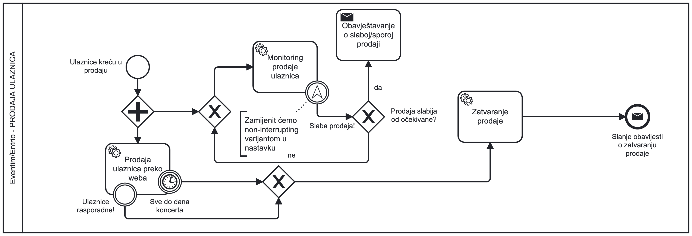</img>

> Slika 25. Isječak iz procesa "Organizacija koncerta u Pulskoj Areni" s dva _interrupting boundary eventa_ na aktivnosti "Prodaja ulaznica preko weba".

---

Pogledat ćemo još jedan jednostavni primjer eskalacijskog _boundary eventa_.

> _Primjer:_ Poslovni proces KUPITI POVLAŠTENU PUTNU KARTU modelira proces prodaje povlaštenih putnih karata u obalnom brodskom prijevozu, što je povlastica stanovnika naših otoka. Pravo na povlašten prijevoz ostvaruje se prilikom kupnje putne karte, a dokazuje se pokazom elektroničke otočne iskaznice (eOtls) koju je izdalo ovlašteno tijelo državne uprave. Radi brže kupnje karata putnik pri ulasku na brod predaje iskaznicu službeniku, koji je očitava na čitaču beskontaktnih "pametnih" kartica. Očitavanjem se automatski poziva web servis koji na osnovi upita u središnju bazu podataka službeniku vraća informaciju o tome može li se prema toj eOtls izdati povlaštena putna karta. Službenik na ulazu u brod identificira putnika prema slici na eOtls-u pa može uočiti ako je eventualno riječ o zloupotrebi prava (npr. ako kartu kupuje osoba koja nije nedvojbeno slična licu s fotografije na eOtls-u), ali nema vremena za dodatnu verifikaciju. On će putniku izdati povlaštenu putnu kartu (jer nije ovlašten da mu uskrati pravo na putovanje), ali će zadržati eOtls i poslati je kontroloru, koji će provesti dodatnu identifikaciju te eventualno oduzeti povlaštenu putnu kartu ako se utvrdi zloupotreba.

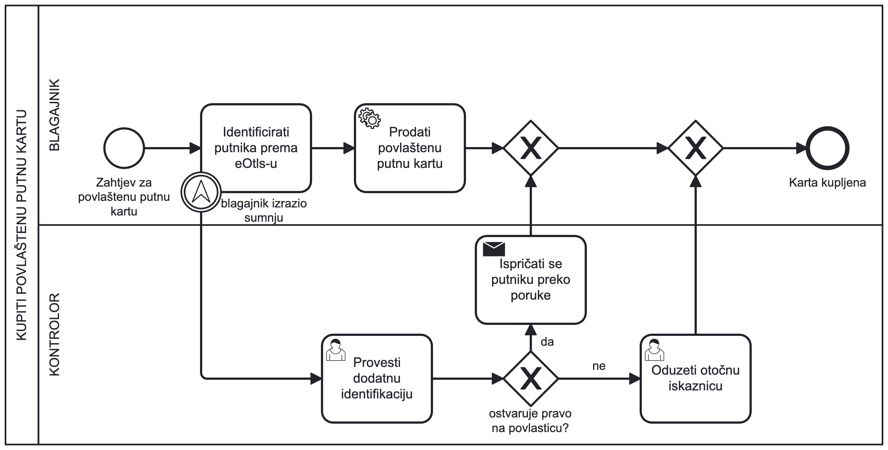</img>

> Slika 26. Primjer modeliranog procesa KUPITI POVLAŠTENU PUTNU KARTU s _non-interrupting escalation boundary eventom_ vezanim za aktivnost "Identificirati putnika prema eOtls-u" kojim se hvata eskalacija "blagajnik izrazio sumnju" i pokreće se slijed aktivnosti kontrolora za dodatnu verifikaciju.

---

Pokazat ćemo još jedan primjer korištenja interrupting message _boundary eventa_ i interrupting error _boundary eventa_ na već poznatom procesu OBRADA NARUDŽBE.

> _Primjer:_ Poslovni proces OBRADA NARUDŽBE je tipičan proces promptnog ispunjavanja narudžbe za isporuku proizvoda iz područnog skladišta. Osnovni je tok procesa vrlo jednostavan: nakon što kupac pošalje narudžbu, skladište je prima, priprema robu za isporuku i šalje je kupcu. Međutim, tijekom procesa mogu se pojaviti različite iznimne situacije koje zahtijevaju posebnu obradu. Na primjer, kupac može poslati zahtjev za otkazivanje ili storniranje narudžbe prije nego što je roba isporučena. U tom slučaju, skladište mora prekinuti proces obrade narudžbe i izvršiti otkazivanje. Također, može doći do greške u sustavu tijekom zaprimanja narudžbe ili utvrđivanja uplate, što također zahtijeva prekid procesa i pokretanje postupka za rješavanje greške.

U ovom primjeru koristimo tri _interrupting boundary eventa_:

1. **Interrupting Error Boundary Event** vezan za aktivnost "Upisivanje narudžbe u ERP" - hvata grešku "Greška u sustavu prilikom upisa narudžbe" i pokreće slijed aktivnosti za rješavanje greške.
2. **Interrupting Escalation Boundary Event** vezan za aktivnost "Provjeriti zalihe robe" unutar potprocesa skladišta PAKIRANJE I OTPREMA ROBE - hvata eskalaciju "Nema robe!" te završava potproces bez otpremanja robe.
3. **Interrupting Message Boundary Event** vezan za **potproces** skladišta PAKIRANJE I OTPREMA ROBE - hvata poruku koja dolazi od kupca "zahtjev za otkazivanje/storniranje narudžbe" i prekida potproces te pokreće slijed aktivnosti za otkazivanje narudžbe.

> **Važno je napomenuti**: _Boundary evente_ možemo koristiti i na potprocesima budući da su potprocesi složene aktivnosti s vlastitim tokom koji možemo detaljnije modelirati. Eskalacijom ovakvog događaja prekidamo cijeli potproces, što je često korisno u praksi. Dodatno, unutar aktivnosti samog potprocesa možemo koristiti boundary evente na pojedinačnim aktivnostima unutar potprocesa, čime se ne prekida cijeli potproces, već samo pojedinačne aktivnosti unutar njega (npr. nema robe unutar aktivnosti "Provjeriti zalihe robe").

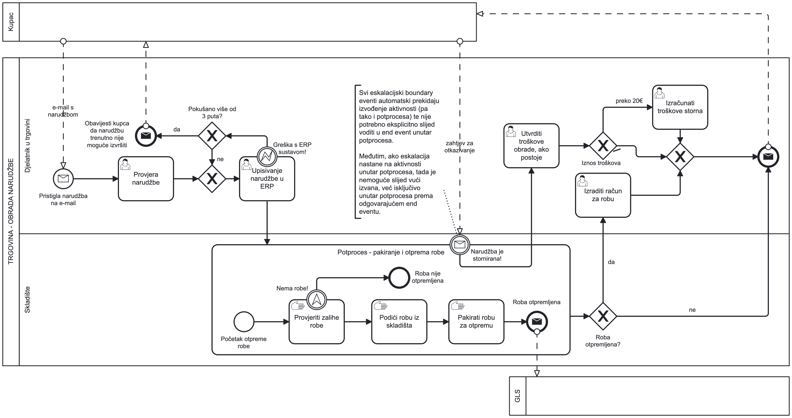</img>

> Slika 27. Primjer modeliranog procesa OBRADA NARUDŽBE s korištenim različitim _interrupting boundary eventima_ na aktivnostima, ali i na potprocesu.

## 2.2 Vrste non-interrupting boundary eventa

Slično kao kod interrupting _boundary eventa_, i _non-interrupting boundary eventi_ dolaze u različitim varijantama ovisno o vrsti okidača koji hvataju. Generalni _non-interrupting boundary event_ može se koristiti za hvatanje različitih vrsta eskalacija, signala ili poruka koje **ne prekidaju aktivnost na koju je vezan**.

_Non-interrupting_ varijante **prikazujemo isprekidanim kružnicama**.

Pokazat ćemo samo najčešće korištene vrste _non-interrupting boundary eventa_ u kontekstu modeliranja poslovnih procesa:

  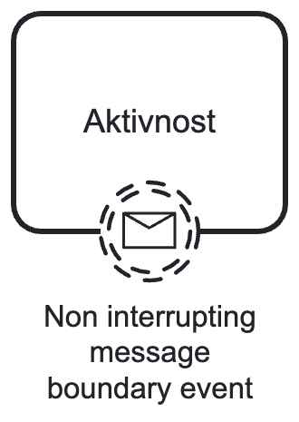
  <code>Non-Interrupting Message Boundary Event</code> <b>(neprekidajući obavještajni boundary događaj)</b>  koristi se za hvatanje dolaznih poruka koje ne prekidaju aktivnost. Zamislimo ga kao <b>signal koji paralelno pokreće dodatnu obradu</b> kada stigne određena poruka, dok se glavna aktivnost normalno nastavlja izvoditi.

_Primjeri imenovanja_: "Obavijest o promjeni zahtjeva", "Dodatni podaci primljeni", "Po primitku zahtjeva s izmjenama", "Stigla dopunska dokumentacija", "Primljen upit o stanju narudžbe"...

  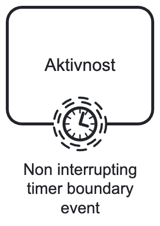
  <code>Non-Interrupting Timer Boundary Event</code> <b>(neprekidajući vremenski boundary događaj)</b>  koristi se za pokretanje dodatne obrade nakon određenog vremenskog razdoblja ili u određenom specificiranom vremenskom trenutku, bez prekidanja aktivnosti. Zamislimo ga kao <b>alarm koji paralelno pokreće dodatnu obradu</b> kada istekne vrijeme, dok se glavna aktivnost normalno nastavlja izvoditi.

_Primjeri imenovanja_: "Podsjetnik nakon 24 sata", "Provjera statusa nakon tjedan dana", "Tri dana poslije primitka narudžbe"...

  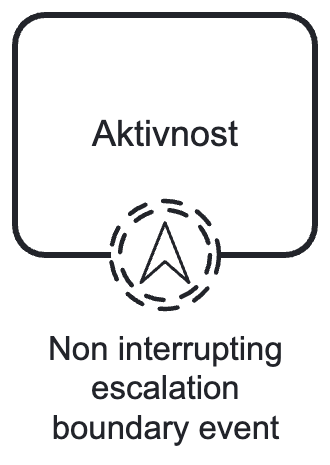
  <code>Non-Interrupting Escalation Boundary Event</code> <b>(neprekidajući eskalacijski boundary događaj)</b>  koristi se za hvatanje eskalacija koje ne prekidaju aktivnost. Eskalacije se obično koriste za označavanje situacija koje zahtijevaju hitnu pažnju ili intervenciju. Zamislimo ga kao <b>signal upozorenja koji paralelno pokreće dodatnu obradu</b> kada se dogodi eskalacija, dok se glavna aktivnost normalno nastavlja izvoditi.

_Primjeri imenovanja_: "Utvrđen je određeni rizik", "Sporedni resurs nedostupan", "Dokumentacija kasni", "Projekt kasni", "Evidentirana slaba prodaja ulaznica"...

> Napomena: Postoji još mnogo vrsta _non-interrupting boundary eventa_ (npr. _non-interrupting signal boundary event_), ali se oni rjeđe koriste u kontekstu modeliranja poslovnih procesa, pa ih nećemo detaljnije razmatrati u ovoj skripti.

---

Pogledat ćemo primjer korištenja _non-interrupting escalation boundary eventa_ na već poznatom procesu ORGANIZACIJA KONCERTA U PULSKOJ ARENI. Rekli smo da želimo koristiti ovaj tip _boundary eventa_ na aktivnosti "Monitoring prodaje ulaznica" jer se radi o eskalaciji koja ne zahtijeva prekid aktivnosti, već samo dodatnu pažnju od strane marketinškog tima.

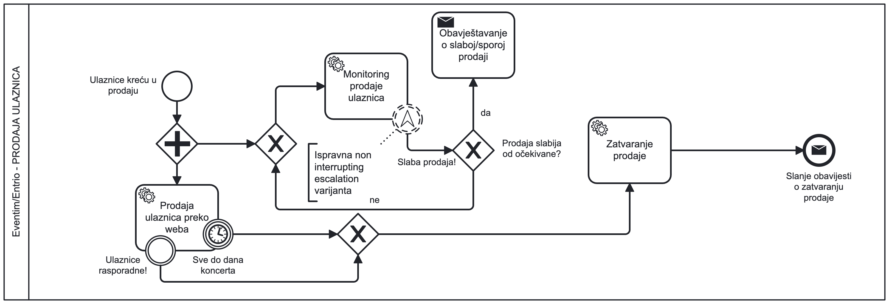</img>

> Slika 28. Primjer modeliranog procesa ORGANIZACIJA KONCERTA U PULSKOJ ARENI s korištenim _non-interrupting escalation boundary eventom_ vezanim za aktivnost "Monitoring prodaje ulaznica" kojim se hvata eskalacija "Evidentirana slaba prodaja ulaznica" i pokreće se slijed aktivnosti marketinškog tima za poboljšanje prodaje ulaznica, dok se glavna aktivnost normalno nastavlja izvoditi.

Sve preostale _non-interrupting boundary evente_ možemo koristiti na isti način, samo moramo paziti da ne prekidaju glavnu aktivnost na koju su vezani.

Primjerice, možemo nadograditi proces OBRADA NARUDŽBE s _non-interrupting message boundary eventom_ vezanim za potproces skladišta PAKIRANJE I OTPREMA ROBE koji hvata poruku "upit o statusu narudžbe" od kupca i pokreće slijed aktivnosti za informiranje kupca o statusu narudžbe, dok se glavni potproces normalno nastavlja izvoditi.

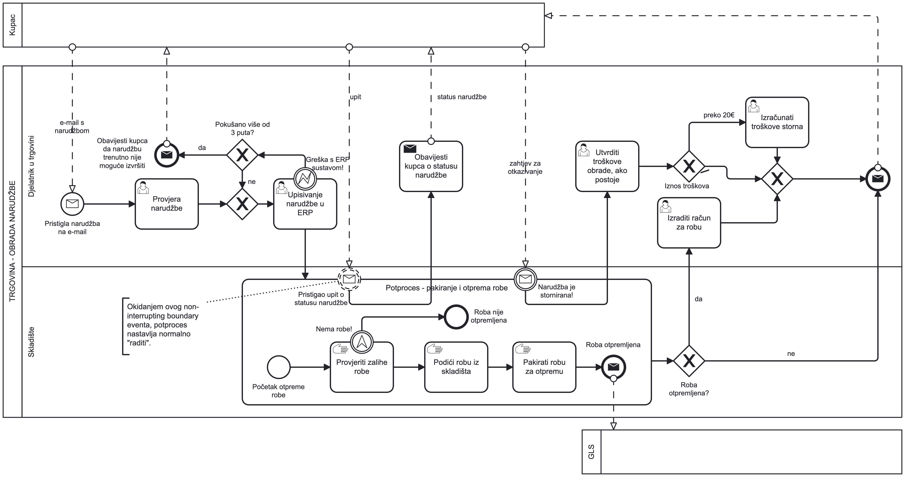</img>

> Slika 29. Primjer modeliranog procesa OBRADA NARUDŽBE s korištenim _non-interrupting message boundary eventom_ vezanim za potproces skladišta PAKIRANJE I OTPREMA ROBE kojim se hvata poruka "upit o statusu narudžbe" od kupca i pokreće slijed aktivnosti za informiranje kupca o statusu narudžbe, dok se potproces normalno nastavlja izvoditi.

# 3. Predlošci tokova rada

Poslovni procesi s kojima se susrećemo izgledaju nam međusobno vrlo različiti: čini se da svaki od njih ima svoje specifične ciljeve, da se provodi u drugom okruženju i da raspolaže drugim resursima. Premda je to točno, dublja studija ipak otkriva da u logičkoj strukturi modela procesa ima mnogo više sličnosti nego što se to čini u prvom trenutku. Ta se sličnost može utvrditi na dvjema (možemo reći **makro** i **mikro**) razinama.

### Sličnost na razini poslovne domene (tzv. makrorazina) <!-- omit in toc -->

U dosadašnjim primjerima razmatrali smo modele koji bi se mogli primijeniti u više različitih organizacija. Tako se npr. roba široke potrošnje iz svakog veleprodajnog skladišta distribuira prema modelu koji je sličan onom koji smo spomenuli na početku vježbi (narudžba, otprema, dostava). Iako se detalji mogu razlikovati, osnovni tok poslovnog procesa je isti, odnosno aktivnosti se provode prema općoj shemi: PRIHVATITI NARUDŽBU → PROVJERITI MOGUĆNOST ISPORUKE → IZUZETI ROBU IZ SKLADIŠTA → OTPREMITI ROBU KUPCU → IZRADITI RAČUN.

Ako prepoznamo tipske procese u više uspješnih organizacija u određenom poslovnom području, moći ćemo izabrati one koji najbolje odgovaraju našem poslovanju (_engl. best practice_) ili ih optimizirati i prilagoditi svojim specifičnim potrebama. Takva tipizacija procesa vodi nas do tzv. **referentnih poslovnih procesa** (obično ih nude proizvođači sustava ERP).

### Sličnost na razini aktivnosti koje čine proces (tzv. mikrorazina) <!-- omit in toc -->

U dosadašnjim smo primjerima vidjeli da se svaki poslovni proces sastoji od niza objekata toka koji su međusobno povezani slijednim (_engl. sequential flow_) ili informacijskim vezama (_engl. message flow_). Već letimična analiza pokazuje da se u različitim procesima često ponavljaju odnosi između objekata toka, kao na primjer:

- **slijed** (AKTIVNOST A → slijedna veza → AKTIVNOST B → slijedna veza → AKTIVNOST C...)
- **izbor** (AKTIVNOST A nakon koje slijedi AKTIVNOST B ili AKTIVNOST C ili AKTIVNOST D...)
- **paralelno izvođenje** dviju ili više aktivnosti itd.

Za navedene tipične oblike odnosa između objekata toka uobičajen je naziv **predlošci tokova rada** (_engl. workflow patterns_).

Predložaka za upravljanje tokom rada ima jako puno, a moguće ih je podijeliti u nekoliko kategorija. U nastavku će, kroz potpoglavlja, biti prikazani neki od najčešće korištenih predložaka tokova rada.

## 3.1 Osnovni predlošci za upravljanje slijedom

U ovoj grupi je ukupno **pet predložaka o upravljanju slijedom izvođenja aktivnosti**. Gotovo sve ste ih već nesvjesno koristili u dosadašnjim primjerima modeliranja procesa. Ovdje ćemo ih još jednom navesti teorijski i ukratko objasniti.

Koristit ćemo sljedeće oznake za predloške:

- `WCP` (_Workflow Control Pattern_) - kratica za definiranje predloška
- `A` - aktivnost
- `P` - polje
- `O` - entitet na informacijskoj vezi
- `S` - skretnica

### WCP-1 Slijed (engl. Sequence)

Neka aktivnost (npr. `A2`) može započeti ako je završena aktivnost koja joj prethodi (npr. `A1`).

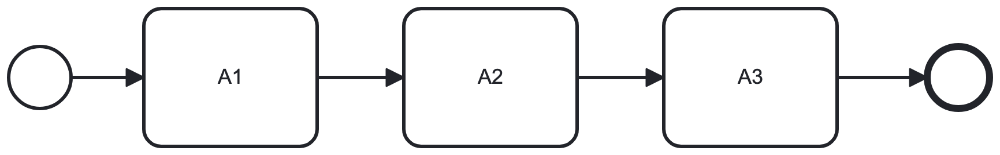</img>

> Slika 30. Primjer predloška WCP-1: Slijed između dvije aktivnosti

Ipak, treba podsjetiti na to kako aktivnosti modelirati kada ih izvode različiti sudionici, u različitim poljima. Koristimo `Message Flow` za komunikaciju između polja te odgovarajuće **međudogađaje**:

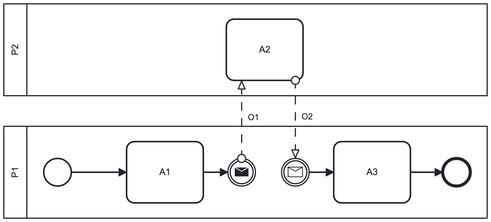</img>

> Slika 31. Primjer predloška WCP-1: Slijed između dvije aktivnosti u različitim poljima

### WCP-2 Paralelno dijeljenje (engl. Parallel Split)

Nakon neke aktivnosti proces se dijeli u više paralelnih grana. To znači da nakon završetka `A1` mogu započeti aktivnosti `A2` i `A3` i `A4` te se obavljati istodobno, a iza svake od njih može slijediti neka druga aktivnost.

**Aktivnosti koje započnu istodobno mogu završiti u različito vrijeme.**

Od jedne **značke** (_engl. token_) koja ulazi u paralelnu skretnicu `S1`, uvijek se stvara (bez provjere uvjeta) onoliko kopija koliko ima izlaznih grana i svaka od tih kopija značke dalje se kreće po jednoj od paralelnih grana.

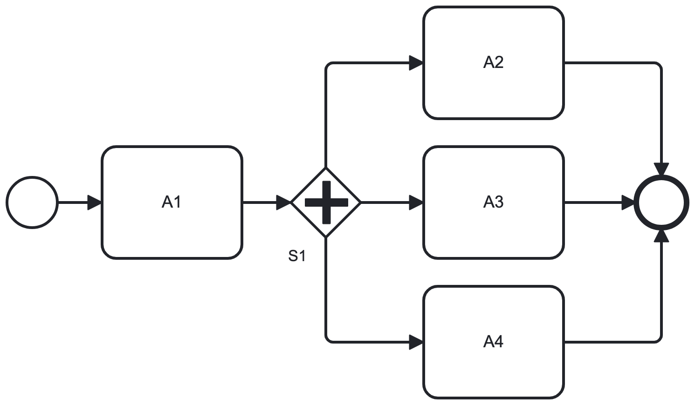</img>

> Slika 32. Primjer predloška WCP-2: Paralelno dijeljenje

### WCP-3 Sinkronizacija (engl. Synchronization)

Neka aktivnost može početi ako su prije nje završene aktivnosti na svim paralelnim granama (mogu biti dvije ili više). To znači da aktivnost `A5` može započeti tek nakon što su završene aktivnosti `A2`, `A3` i `A4`. U **paralelnoj skretnici spajanja S2** (_engl. AND Merge_) sve se ulazne značke uvijek spajaju, bez provjere uvjeta, **u jednu izlaznu**.

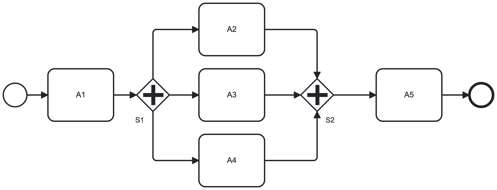</img>

> Slika 33. Primjer predloška WCP-3: Sinkronizacija

### WCP-4 Ekskluzivni izbor (engl. Exclusive Choice)

Nakon neke aktivnosti proces će se nastaviti **samo u jednoj** od više mogućih grana. To znači da će nakon `A1` biti izvedena aktivnost `A2` ili `A3` ili `A4` (odnosno slijed kojem su one na početku). Značka koja ulazi u ekskluzivnu XOR skretnicu `S1` ne dijeli se, već nastavlja jednim od putova koji udovoljava uvjetu što se ispituje prije te skretnice.

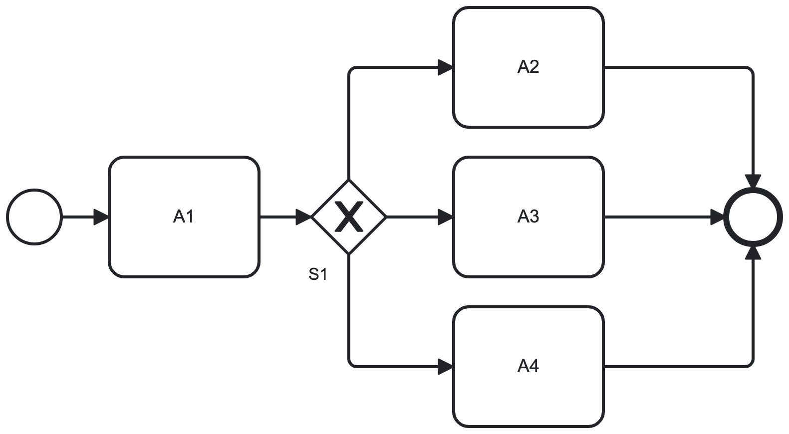</img>

> Slika 34. Primjer predloška WCP-4: Ekskluzivni izbor

### WCP-5 Jednostavno spajanje (engl. Simple Merge)

Neka aktivnost može početi čim je izvedena neka od aktivnosti koje su se izvodile u dva ili više paralelnih sljedova. To znači da aktivnost `A5` može započeti kad završi jedna od aktivnosti `A2`, `A3` ili `A4` (odnosno slijed na čijem se kraju nalazi ta aktivnost). Aktivnost `A5` će pokrenuti ona značka koju je ekskluzivna skretnica `S1` uputila na neki od sljedova, a koja je prošla kroz ekskluzivnu skretnicu spajanja `S2`.

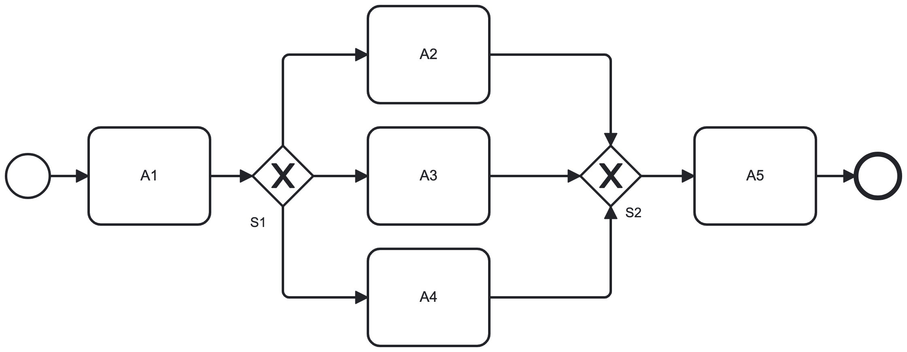</img>

> Slika 35. Primjer predloška WCP-5: Jednostavno spajanje

## 3.2 Predlošci za grananje, sinkronizaciju i iteraciju

U ovoj grupi su predlošci koji se koriste za grananje i sinkronizaciju toka izvođenja aktivnosti. Uobičajeno se koriste u situacijama kada je potrebno izvršiti nekoliko aktivnosti istovremeno ili kada se proces nastavlja samo ako su završene sve aktivnosti koje su se izvodile u paralelnim granama.

### WCP-6 Višestruki izbor (engl. Multiple Choice)

Nakon neke aktivnosti proces se može nastaviti u jednoj, dvjema ili u više mogućih grana, **ali najmanje u jednoj**. To znači da poslije `A1` može biti izvedena bilo koja aktivnost ili bilo koje dvije aktivnosti ili sve tri aktivnosti od mogućih `A2`, `A3` i `A4`.

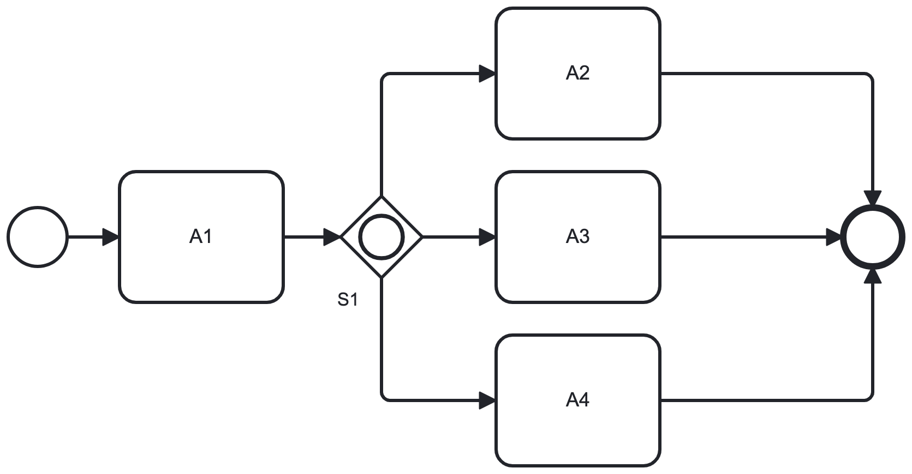</img>

> Slika 36. Primjer predloška WCP-6: Višestruki izbor

### WCP-7 Strukturno sinkronizirano spajanje (engl. Structured Synchronizing Merge)

Neka aktivnost može početi ako su izvedene sve aktivnosti koje su se izvodile u dvama ili u više paralelnih sljedova stvorenih ranije u procesu. To znači da `A5` može započeti kad je završila jedna ili više aktivnosti od mogućih `A2`, `A3` i `A4` koje su pokrenule kopije značaka stvorene u inkluzivnoj skretnici grananja (`S1`). Drugim riječima, u `S2` se sinkroniziraju (ili spajaju) kopije onih značaka koje su prije toga stvorene u `S1`. Bez obzira na to koliko je kopija značaka ušlo u izlaznu skretnicu `S2`, izaći će samo jedna.

U poslovnom smislu to znači da će se procesna instanca, koja je obrađena u `A1`, moći obraditi u `A5` nakon što je provedena barem jedna ili više aktivnosti iz skupa `A2`, `A3` i `A4`.

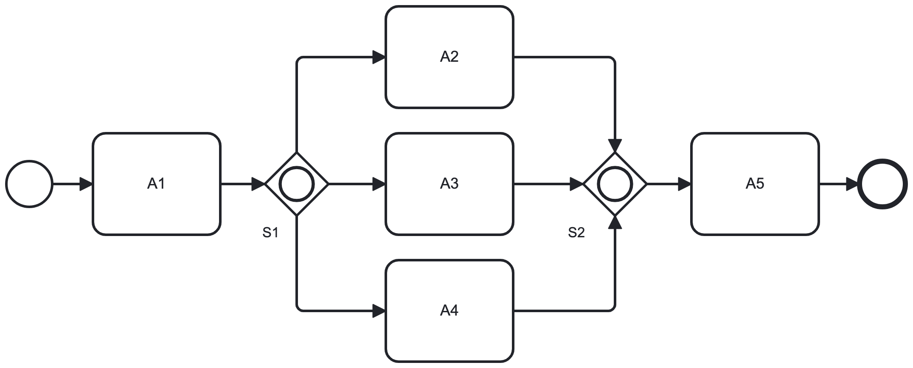</img>

> Slika 37. Primjer predloška WCP-7: Strukturno sinkronizirano spajanje

### WCP-8 Nesimetrično sinkronizirano spajanje (engl. Acyclic Synchronizing Merge)

Neka aktivnost može početi ako su izvedene sve aktivnosti na dva ili više paralelnih sljedova, stvorenih ranije u procesu na inkluzivnoj skretnici `S1`, ali se odluka o tome što treba spojiti donosi na temelju **međudogađaja** koji prethode ekskluzivnoj skretnici spajanja `S2`.

**Nesimetrično spajanje** riješeno je kombinacijom inkluzivne skretnice `S1` (koja će stvoriti jednu, dvije ili tri značke na bilo kojem od tri slijeda) te uvjetovanih događaja na sva tri slijeda ispred konvergentne ekskluzivne skretnice `S2`. Ti će uvjetovani događaji dopustiti izvođenje aktivnosti "Pokrenuti marketinške akcije" kad završe one od prethodnih aktivnosti koje se moraju uskladiti.

</img>

> Slika 38. Primjer predloška WCP-8 na primjeru procesa organizacije marketinške kampanje: Nesimetrično sinkronizirano spajanje

Izvođenje aktivnosti u složenom poslovnom procesu slično je izvođenju procedura u složenom programu. Simboli BPMN-a omogućuju prikaz takvih struktura kao što su `GOTO`, `WHILE...DO`, `REPEAT...UNTIL` u programiranju.

Međutim, u poslovnoj praksi česte su i druge strukture, nepoznate u strukturnom programiranju, koje opisuju ponavljanje odnosno **iteracije** pojedinačne aktivnosti ili grupe aktivnosti.

### WCP-9 Proizvoljno ponavljanje (engl. Arbitrary Cycles)

Ovaj predložak opisuje točku u procesu nakon koje se može ponoviti jedna ili više aktivnosti. Općenito, unaprijed se ne zna treba li uopće nešto ponavljati i ako treba - koliko puta, već je to specifično za svaku instancu procesa pa se stoga to naziva još i **nestrukturiranom petljom**.

Tipičan primjer za ovaj predložak može se pronaći u zdravstvu, a prikazan je na sljedećem primjeru:

</img>

> Slika 39. Primjer predloška WCP-9: Proizvoljno ponavljanje

Primarna zdravstvena zaštita kod nas funkcionira tako da pacijent najprije odlazi na pregled svom osobnom liječniku. Osobni liječnik nakon pregleda odlučuje koje su dodatne pretrage potrebne te za njih izdaje uputnice. Laboratorij ili specijalist će "Obaviti pretragu i izdati nalaz" te zadržati uputnicu (radi obračuna usluge), a pacijent (ako ima još uputnica) će otići na sljedeću pretragu. Osobni će liječnik "Odrediti način liječenja" na temelju nalaza provedenih pretraga. Broj laboratorijskih pretraga ovisi o potrebama pacijenta i njegovoj bolesti.

Ovo je zanimljiv primjer proizvoljnog ponavljanja gdje XOR skretnica spajanja **prethodi** XOR skretnici grananja.

## 3.3 Predlošci za okidače

U ovom potpoglavlju prikazat ćemo nekoliko predložaka koji se koriste za modeliranje okidača u poslovnim procesima. **Okidači** su događaji koji pokreću izvođenje procesa, a mogu biti izazvani **vremenski**, **porukom** ili **signalom**.

### WCP-10 Prolazni okidač (engl. Transient Trigger)

Predložak opisuje proces u kojem izvođenje jedne aktivnosti ovisi o nekom vanjskom poticaju ili drugom procesu (odnosno, vanjski poticaj "okida" aktivnost).

Okidač koji to omogućuje zovemo prolaznim jer nestaje ako u osnovnom procesu već ne čeka instanca koja bi se mogla pokrenuti. Prolazni okidač zapravo je običan prijamni međudogađaj (npr. `Message Intermediate Catch Event`) koji se koristi za hvatanje signala ili poruka od drugih procesa.

Primjer opisuje rad noćnog čuvara u nadziranom objektu. Čuvar će se poslije dolaska (u 20 sati) smjestiti u kontrolnu sobu i "Uključiti nadzorni sustav" koji se sastoji od kamera i senzora kretanja. Ako senzor registrira pokret u objektu, on će "Poslati signal" u kontrolnu sobu. Ako je čuvar u sobi, on će "Provjeriti ishodište alarma". Ako pak čuvara nema, poslani signal neće biti iskorišten i propast će (zato ga zovemo prolaznim).

</img>

> Slika 40. Primjer predloška WCP-10: Prolazni okidač

### WCP-11 Stalni okidač (engl. Persistent Trigger)

Izvođenje aktivnosti u ovom predlošku također ovisi o nekom vanjskom poticaju ili drugom poslovnom procesu (vanjski poticaj okida aktivnost). Okidač djeluje stalno i aktivan je sve dok na njega dolaze instance procesa, a modelira se također kao prijamni događaj (npr. `Message Intermediate Catch Event`) u osnovnom procesu.

Ishodište iz kojeg dolazi poticaj i ovdje se modelira kao predajni međudogađaj (npr. `Message Intermediate Throw Event`) koji šalje ciljanu obavijest određenom okidaču.

Stalni okidač djeluje slično kao prolazni, a **razlika je u tome što se vanjski poticaj ne gubi ako u osnovnom procesu trenutno nema instance koja bi na njega čekala**. Sljedeći primjer pokazuje izradu prozora. Prozor se izrađuje u tri faze: a) izrada prozorskog okvira od drva ili profilirane plastike, b) izrada izolacijske kutije od dvije ili tri staklene ploče između kojih je inertni plin, a razmak održavaju letvice s brtvom i c) ugradnja izolacijske kutije u pripremljeni prozorski okvir.

Zbog različitih tehnologija u fazama a) i b) ti se poslovi organiziraju u dvije radionice. Prvi ćemo odjel nazvati IZRADA I MONTAŽA PROIZVODA, a drugi je staklarska radionica IZRADA IZOLACIJSKE KUTIJE. Prvi odjel vodi posao i održava kontakt s kupcima, a drugi je odjel kooperant (_outsourced_).

Kada prvi odjel primi narudžbu, on će "Izraditi nacrt proizvoda" i kopiju poslati staklarskoj radionici te nastaviti s aktivnošću "Izraditi prozorski okvir". Staklarska će radionica prema nacrtu "Izraditi izolacijsku kutiju" i poslati je vodećem odjelu koji, nakon primitka gotove izolacijske kutije, može "Ugraditi izo-kutiju u okvir". Dakle, prijamni događaj "Primljena izolacijska kutija" **okidač** je za ovu aktivnost. Upravo se u ovom detalju vidi bitna razlika između prolaznog i stalnog okidača: vanjski poticaj (ovdje je to tok: "Gotova izolacijska kutija") neće se izgubiti ako u okidaču "Primljena izolacijska kutija" **još nema odgovarajuće instance procesa** (odnosno gotovoga prozorskog okvira), već će se iskoristiti (ovdje to znači ugraditi) kad naiđe ta instanca (odnosno kad prozorski okvir bude gotov).

Analizom modela može se utvrditi da su u procesu zapravo **dva stalna okidača**.

Prvi smo već naveli i on je modeliran eksplicitno. Međutim, drugi okidač modeliran je implicitno i određen svojstvom prijamne aktivnosti "Izraditi ukupni račun za prozor". U tu aktivnost ulazi poruka (entitet) - "Račun za staklarske radove" iz emitirajućeg međudogađaja "Poslan račun za staklarske radove" i pokreće se ("okida") njezino izvođenje.

</img>

> Slika 41. Primjer predloška WCP-11: Stalni okidač

# Zadaci za Vježbu 4

## 1. ServisPlus d.o.o. - Popravak kućanskih uređaja

Vlasnik apartmana koji iznajmljuje smještaj turistima koristi usluge servisne tvrtke ServisPlus d.o.o. za održavanje i popravak kućanskih uređaja u apartmanima. Proces započinje u trenutku kada vlasnik apartmana prijavi kvar na uređaju (npr. na perilici rublja, hladnjaku ili klima-uređaju) putem web obrasca ili telefonskim pozivom.

Nakon zaprimanja prijave djelatnik servisnog centra evidentira zahtjev i provjerava osnovne informacije o apartmanu, vrsti uređaja i prirodi kvara. Ako su podaci nepotpuni, vlasnik apartmana se kontaktira radi dopune informacija. Nakon što evidentira zahtjev, djelatnik dodjeljuje servisera i s vlasnikom apartmana dogovara termin dolaska. Pritom mora uzeti u obzir potencijalni utjecaj na boravak gostiju u apartmanu (i njihovu suglasnost), kako bi se izbjeglo ometanje njihovog boravka.

Na dogovoreni dan serviser dolazi u apartman i započinje popravak uređaja. Tijekom izvođenja popravka moguće je da se utvrdi kako je potreban dodatni rezervni dio koji trenutačno nije dostupan, zbog čega se popravak privremeno obustavlja do nabave rezervnog dijela u suradnji s vanjskim dobavljačem. U međuvremenu gosti u apartmanu mogu izraziti nezadovoljstvo zbog neispravnog uređaja ili ometanja boravka, što vlasnik apartmana mora pravovremeno komunicirati servisnom centru kako bi se pronašlo rješenje (npr. ubrzanje nabave rezervnog dijela, privremena zamjena uređaja ili financijska kompenzacija).

Za popravak je predviđeno određeno vrijeme. Ako se pokaže da će popravak potrajati dulje od predviđenog, vlasnik apartmana mora biti pravovremeno obaviješten kako bi mogao reagirati prema gostima (npr. ponuditi alternativno rješenje ili financijsku kompenzaciju). Gosti ili vlasnik apartmana mogu u bilo kojem trenutku poslati upit o statusu popravka, na koji servisni centar odgovara bez prekidanja samog izvođenja servisa.

U iznimnim situacijama gosti mogu zahtijevati hitno rješavanje problema ili zaprijetiti negativnom recenzijom pa i povratom novca, što vlasnik apartmana eskalira servisnom centru radi ubrzavanja postupka ili promjene prioriteta. Također, prije dolaska servisera vlasnik apartmana može otkazati zahtjev ako se kvar riješi na drugi način ili ako gosti naposljetku napuste apartman.

Nakon što je popravak uspješno završen, serviser potvrđuje izvršenu uslugu, a vlasniku apartmana se automatski dostavljaju račun i potvrda o obavljenom popravku. Time se proces završava.

## 2. McDonalds franšiza - Obrada, priprema, dostava i naplata narudžbi

McDonalds je poznata globalna franšiza brze hrane s oko 40.000 restorana u više od 100 zemalja svijeta. Svaki restoran posluje prema standardiziranim procedurama i procesima kako bi osigurao dosljednost u pružanju usluga i proizvoda. Svoje poslovne procese, McDonalds detaljno dokumentira i standardizira svoje operativne procedure i poslovne procese, uključujući obradu narudžbi, pripremu hrane, dostavu i naplatu. Svaki franšizni restoran ima jasno definirane korake i protokole koji se moraju slijediti kako bi uopće dobili licencu za rad.

Vaš zadatak je modelirati proces obrade narudžbe, pripreme hrane, dostave hrane i naplate u McDonalds restoranu. Proces započinje kada je kupac gladan, a naručivanju može pristupiti na sljedeće načine:

- preko mobilne aplikacije (npr. Glovo, Wolt)
- odlaskom u restoran i narudžbom na šalteru
- odlaskom u restoran i narudžbom putem kioska za samostalno naručivanje
- odlaskom u Drive Thru

Potrebno je modelirati svaki od navedenih načina naručivanja koje kupac može odabrati. Jedan od načina je da kupca prikažete kao polje (Kupac, Kupac - naručivanje hrane, itd.) te načine naručivanje prikažete kao staze unutar tog polja.

Morate modelirati i perspektivu blagajnika (npr. polje blagajnik, ili McDonalds - obrada narudžbi) te perspektivu kuhinje (npr. polje kuhinja, ili McDonalds - priprema hrane).

Vaš zadatak je ispravno sprovesti sve aktivnosti koji se odvijaju između kupca, blagajnika i kuhinje, uključujući i potencijalnog dostavljaća, od događaja "Kupac je gladan" do događaja "Kupac je sit".

Perspektivu dostavljača modelirajte u zasebnom polju (npr. polje dostavljač, ili Wolt/Glovo - dostava hrane).

Potrebno je uzeti u obzir:

- različite načine naručivanja i interakcije između kupca, blagajnika i kuhinje
- različite scenarije koji se mogu dogoditi tijekom procesa, uključujući moguće eskalacije, kašnjenja, upite o statusu narudžbe i druge situacije koje zahtijevaju dodatnu pažnju ili intervenciju
- načine plaćanja, uključujući gotovinu, kartice i mobilne aplikacije
- McDonalds Loyalty program (McDonalds aplikacija)
- veliku gužvu u restoranu, što može utjecati na vrijeme pripreme i dostave narudžbe
